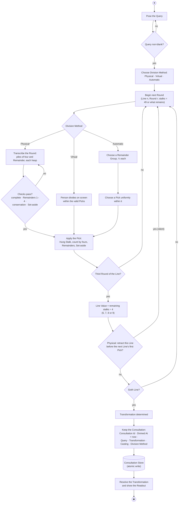
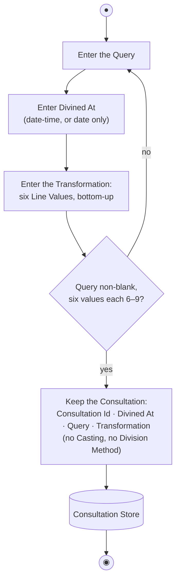
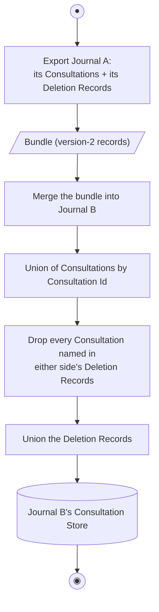

# UML activity diagrams

Sources: CONTEXT.md (Casting vocabulary),
[ADR-0023](../adr/0023-random-division-equiprobable-remainder-groups.md),
[ADR-0026](../adr/0026-consultation-is-cast-or-recorded.md),
[ADR-0027](../adr/0027-cast-consultation-records-division-method.md),
[ADR-0046](../adr/0046-consultation-record-v2-and-markdown-store.md),
[ADR-0037](../adr/0037-application-layer-channels-and-journals.md).

## 1. Cast a Consultation

One Casting is eighteen Rounds: six Lines, bottom-up, three Rounds each. The
only branch that differs by Division Method is how a Round's Pick is obtained.

Notes:

- A Pick is valid when it leaves at least one stalk in the left heap, and at
  least one countable stalk in the right heap after the Hung Stalk is taken.
  With N stalks, the valid Picks are 1 … N − 2.
- **Retract a Line** discards that Line's Picks and returns to its first
  Round. It is drawn only after a Line completes, but it is also available
  during an incomplete Line. Nothing about it is kept.
- A Casting is never rewound. A Pick, once applied and not retracted, stays.

## 2. Record a Consultation

No Casting is ever invented for a Recorded Consultation: many Pick sequences
give the same Transformation.

## 3. Merge Journals

Merging is symmetric and idempotent, and it has no conflicts: Consultations
are immutable and Consultation Ids are unique. A bundle contains private data
and must never be committed to the repository.
