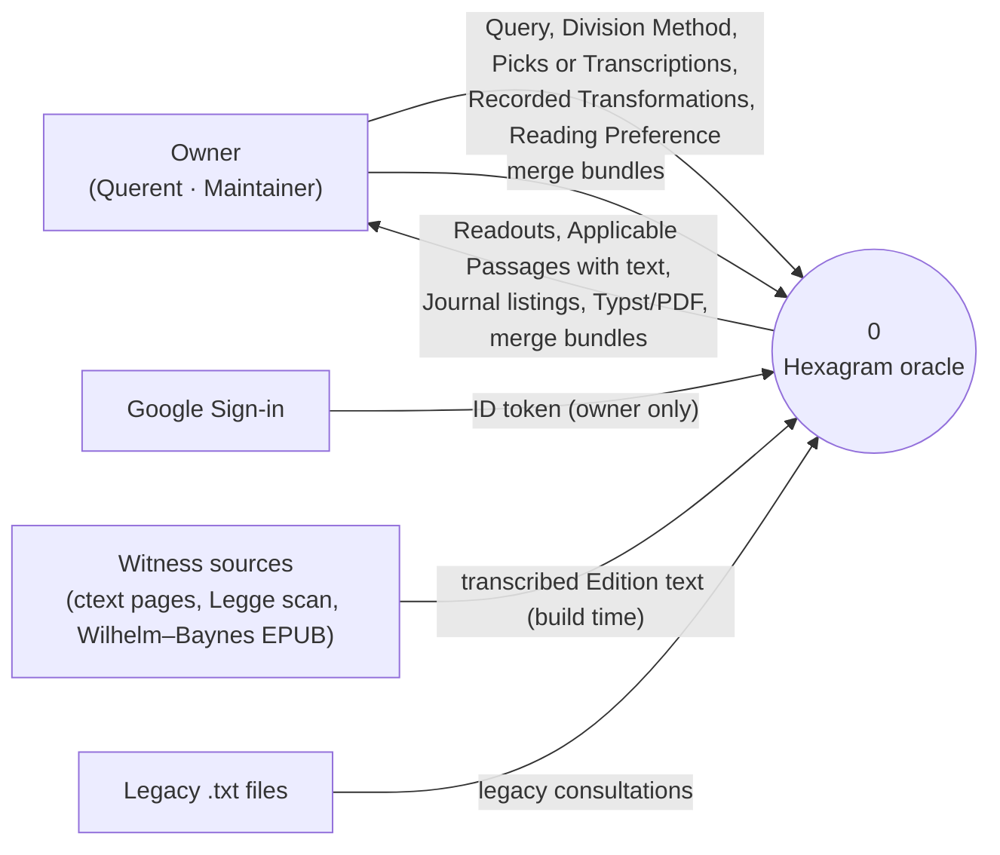
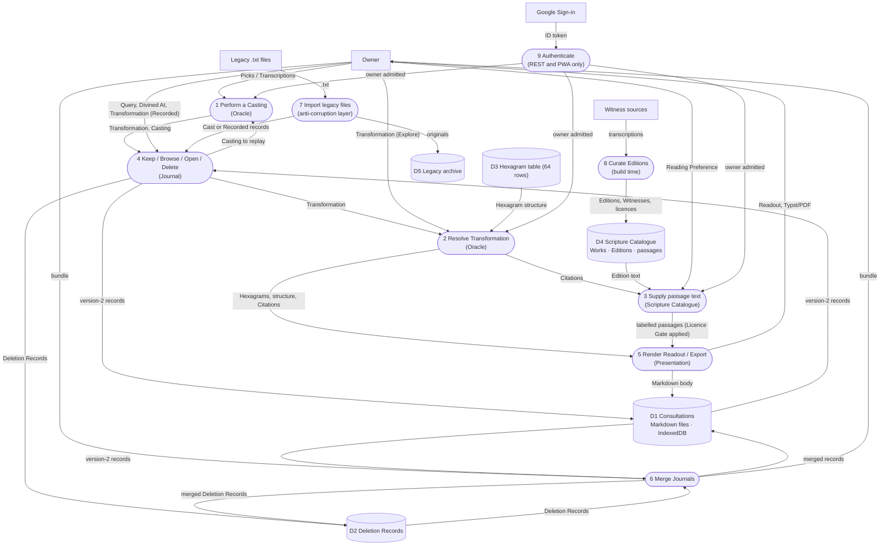

# Data Flow Diagrams

Notation: rectangles are external entities, rounded boxes are processes, and
cylinders are data stores.

## Level 0: context diagram

## Level 1

Notes:

- The Oracle (processes 1 and 2) reads only D3 and holds no other data.
  Everything it produces is a pure function of its input.
- The Markdown body (P5 → D1) is decorative. The Journal never reads it back
  (ADR-0046).
- Process 9 guards the REST engine (and therefore the PWA). The CLI does not
  authenticate. All channels are Private Channels (ADR-0032).
- Process 8 is the build-time curation of Editions from Witnesses. It is not a
  runtime use case.
