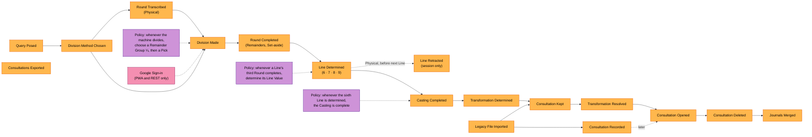

# EventStorming

Notation follows EventStorming's sticky colours:

| Sticky             | Meaning                               |
| ------------------ | ------------------------------------- |
| 🟧 Domain event    | something that happened (past tense)  |
| 🟦 Command         | an intention to make something happen |
| 🟨 Actor           | who issues the command                |
| 🟪 Policy          | "whenever …, then …"                  |
| 🟩 Read model      | what the actor looks at to decide     |
| 🩷 External system | outside the boundary                  |
| 🟥 Hotspot         | open question or risk                 |

## Big Picture timeline

### Timeline, with commands, actors and read models

| #   | 🟦 Command             | 🟨 Actor             | 🟧 Event                                      | 🟩 Read model                 | 🟪 Policy / notes                                                                    |
| --- | ---------------------- | -------------------- | --------------------------------------------- | ----------------------------- | ------------------------------------------------------------------------------------ |
| 1   | Pose Query             | Querent              | Query Posed                                   | —                             | Query must be non-blank                                                              |
| 2   | Choose Division Method | Querent              | Division Method Chosen                        | —                             | Physical · Virtual · Automatic                                                       |
| 3   | Transcribe Round       | Querent              | Round Transcribed, or Transcription Rejected  | Round state: stalks, checks   | Physical only; checks: complete, Remainders 1–4, conservation, Set-aside             |
| 4   | Make Division          | Querent / machine    | Division Made (a Pick)                        | valid Picks; Remainder Groups | Pick valid: 1 … N − 2                                                                |
| 5   | —                      | —                    | Round Completed                               | Round result                  | follows from the Pick                                                                |
| 6   | —                      | —                    | Line Determined                               | Casting so far                | after the third Round of a Line                                                      |
| 7   | Retract Line           | Querent              | Line Retracted                                | —                             | Physical only; the incomplete or just-completed Line; leaves no trace in the Casting |
| 8   | —                      | —                    | Casting Completed → Transformation Determined | —                             | after the sixth Line                                                                 |
| 9   | Keep Consultation      | system               | Consultation Kept                             | —                             | assigns Consultation Id; Divined At = Clock now                                      |
| 10  | Record Consultation    | Querent              | Consultation Recorded                         | —                             | no Casting is ever invented                                                          |
| 11  | Resolve Transformation | Querent / API client | Transformation Resolved                       | Readout                       | Applicable Passages: every Moving Line, no ranking                                   |
| 12  | Open Consultation      | Querent              | Consultation Opened                           | Journal list, Readout         | Cast: Casting must replay to the Transformation; nothing written                     |
| 13  | Delete Consultation    | Querent              | Consultation Deleted (Deletion Record kept)   | Journal list                  | permanent                                                                            |
| 14  | Merge Journals         | Querent              | Journals Merged                               | merge summary                 | union by Id minus Deletion Records                                                   |
| 15  | Export Consultations   | Querent              | Consultations Exported                        | Typst / PDF document          | read-only                                                                            |
| 16  | Import Legacy File     | Maintainer           | Legacy File Imported (then Kept or Recorded)  | import report                 | anti-corruption layer                                                                |

Events marked "session only" are never kept: Line Retracted leaves no trace,
and a Casting is never rewound.

## Tactical design, per bounded context

### Oracle (core)

The Oracle has **no entities and no identity-bearing aggregate**. It is
values and pure functions. Its "aggregate" is the Casting, as an immutable
value whose whole state is its Pick sequence.

| Element                     | Kind                         | Notes                                                                          |
| --------------------------- | ---------------------------- | ------------------------------------------------------------------------------ |
| Casting                     | value (consistency boundary) | 0–18 Picks; append-only; complete at 18                                        |
| Pick                        | value                        | the one free choice of a Round                                                 |
| Round, Remainder, Set-aside | values                       | follow from the Pick and the stalks remaining                                  |
| Remainder Groups of a Round | values                       | follow from the stalks remaining; the valid Picks grouped by left Remainder    |
| Line Value, Line Position   | values                       | Position 1 is the bottom                                                       |
| Transformation              | value                        | six Line Values; identity X之Y; 4,096                                          |
| Hexagram, Figure, Trigram   | values                       | 64 Hexagrams; the Figure is the identity                                       |
| Hexagram table              | reference data               | 64 rows: Trigrams, Nuclear / Inverse / Reversed Hexagram, Fuxi Sequence Number |
| Apply Pick                  | domain function              | Casting × Pick → Casting, or a rejected Division                               |
| Resolve                     | domain function              | Transformation → Hexagrams, structure, Applicable Passages (Citations)         |

The **Automatic Division** policy (Remainder Group ¼, then a uniform Pick) is
_not_ part of the Oracle. It lives in the application, beside the Random Source
(ADR-0023, ADR-0029). The Oracle only supplies each Round's valid Picks and
Remainder Groups.

Invariants:

1. A valid Pick is 1 … N − 2 for N stalks.
2. Remainders are 1–4, never 0.
3. The Set-aside is 5 or 9 in the first Round of a Line, and 4 or 8 in the
   second and third.
4. A Casting is fully determined by its Picks.
5. Applicable Passages rank nothing and ignore no Moving Line.

### Consultation Journal (supporting)

| Element                            | Kind                                                       | Notes                                                 |
| ---------------------------------- | ---------------------------------------------------------- | ----------------------------------------------------- |
| Consultation                       | aggregate root (entity)                                    | identity: Consultation Id (ULID); immutable once kept |
| Query, Divined At, Division Method | values                                                     |                                                       |
| Journal                            | the set of Consultations and Deletion Records in one store |                                                       |
| Deletion Record                    | value                                                      | Consultation Id + when deleted                        |
| Consultation Store                 | repository (port)                                          | keep, list, get, remove; Deletion Records             |
| Merge Journals                     | domain service                                             | union by Id minus Deletion Records                    |

Invariants:

1. The Query is non-blank.
2. `casting` is present if and only if `divisionMethod` is.
3. A Cast Consultation's Casting replays to its Transformation.
4. A Consultation is never edited.
5. A deleted Id never returns.

### Scripture Catalogue (supporting)

| Element                     | Kind                           | Notes                                                                       |
| --------------------------- | ------------------------------ | --------------------------------------------------------------------------- |
| Work                        | entity                         | 周易 經, each 十翼 part, 焦氏易林; owns a Citation scheme                   |
| Edition (incl. Translation) | entity                         | one script or language; Witness; licence                                    |
| Witness                     | value                          | concrete source + retrieval                                                 |
| Citation                    | value                          | Edition-independent passage name built on Oracle identities                 |
| Passage text                | read model                     | per Edition, per Citation                                                   |
| Licence Gate                | policy                         | an Edition is shown only on channels its licence permits; never substituted |
| Reading Preference          | value (supplied by the viewer) | script, Translations, Commentaries, Yilin                                   |

### Presentation (generic)

| Element   | Kind       | Notes                                                        |
| --------- | ---------- | ------------------------------------------------------------ |
| Readout   | read model | composes Oracle results with Catalogue text; decides nothing |
| Renderers | adapters   | terminal, Markdown body, Typst/PDF, HAL+JSON                 |
