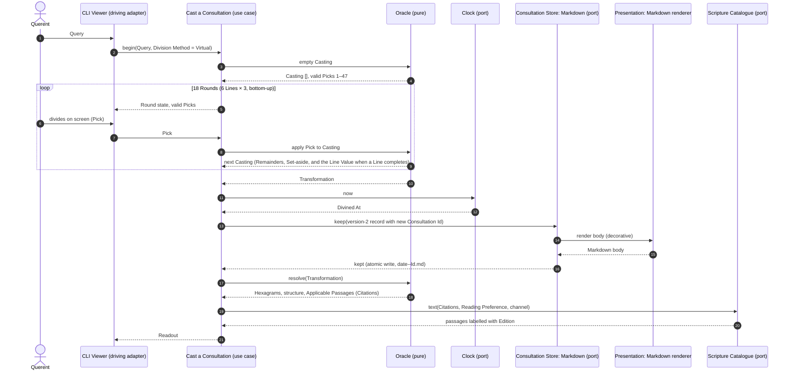
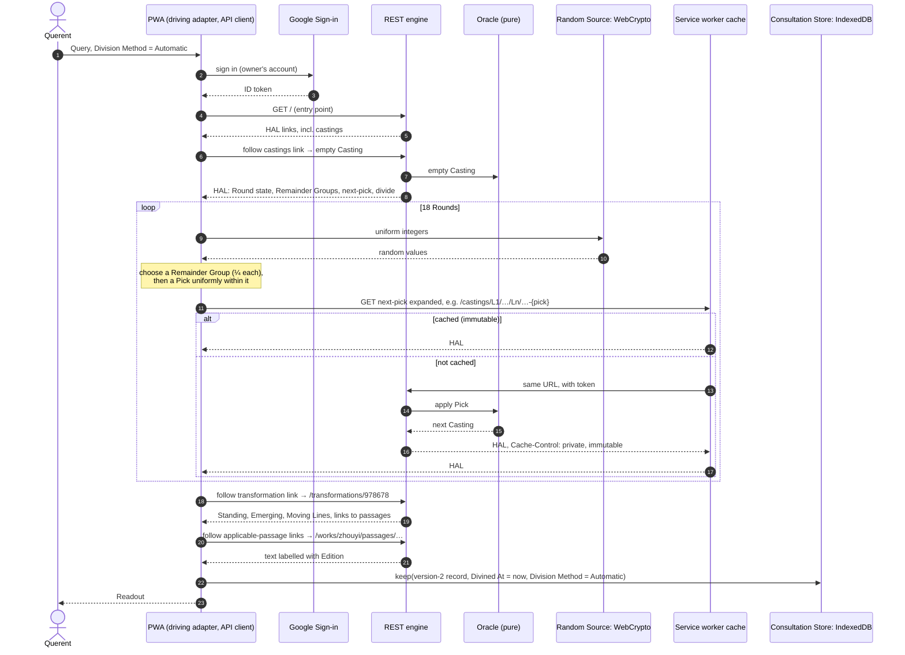
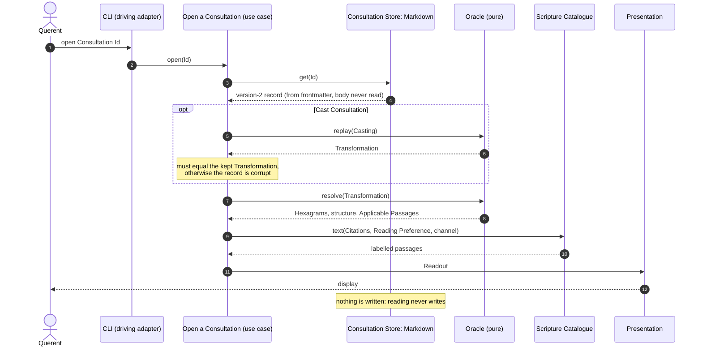
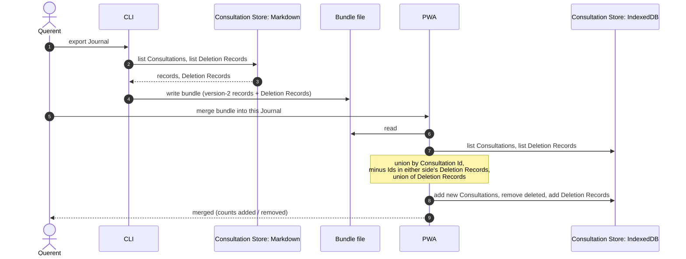

# UML sequence diagrams

Participants are named by their role in the hexagon (ADR-0037): driving
adapters, use cases, the pure Oracle, and driven ports with their adapters.

## 1. Virtual Cast in the CLI

## 2. Automatic Cast in the PWA, via the REST engine

The PWA bundles neither Oracle nor catalogue (ADR-0037). It draws Picks with
WebCrypto and submits each one to the engine.

## 3. Open a Consultation (CLI)

## 4. Merge Journals (CLI → PWA)

