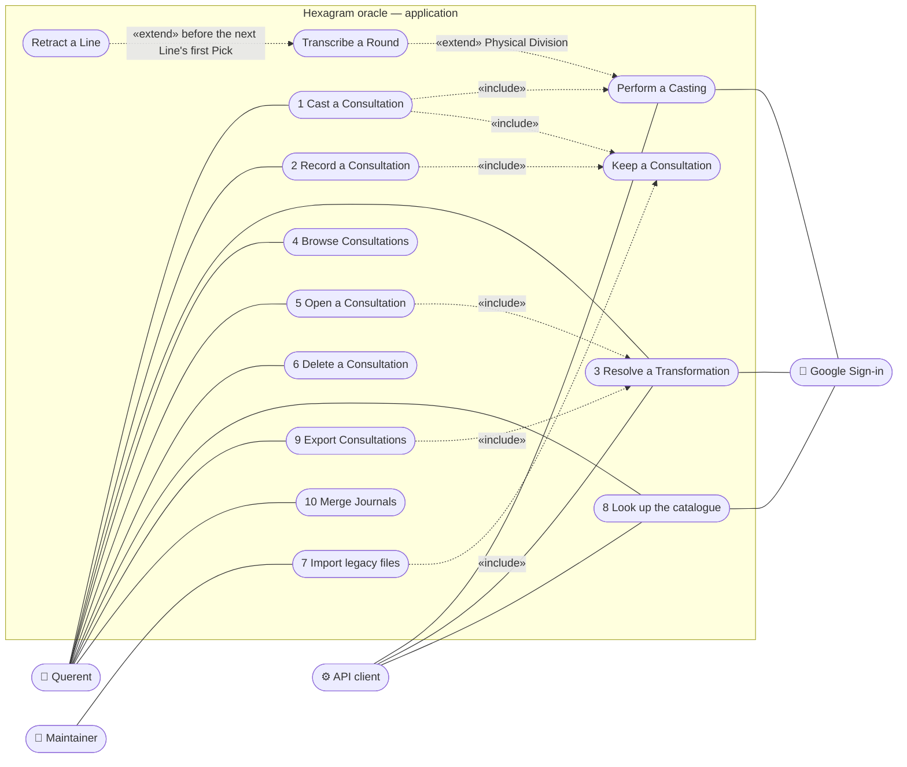

# UML use-case diagram

Source: [ADR-0029](../adr/0029-application-use-cases-and-driven-ports.md)
(use cases 1–9), [ADR-0033](../adr/0033-merging-journals-by-union-with-deletions.md)
(use case 10), [ADR-0031](../adr/0031-rest-engine-resources-and-hypermedia.md)
and [ADR-0034](../adr/0034-pwa-is-a-pure-rest-client.md) (channels).

## Actors

| Actor              | Kind      | Who                                                           |
| ------------------ | --------- | ------------------------------------------------------------- |
| **Querent**        | primary   | the owner, divining or reviewing their Journal                |
| **Maintainer**     | primary   | the owner, doing one-off or maintenance work                  |
| **API client**     | primary   | any program calling the REST engine; today, the PWA           |
| **Google Sign-in** | secondary | identity provider; admits only the owner's account (ADR-0032) |

There is one human: the owner. Querent and Maintainer are roles, not people.
Every channel is a Private Channel.

## Diagram

## Notes

- **Perform a Casting** and **Keep a Consultation** split use case 1 into
  its pure and its stateful halves. They are modelling devices drawn from
  ADR-0031 (the pure Casting resource) and ADR-0029 (the Consultation Store),
  not additional use cases.
- **Perform a Casting** is the pure part of use case 1: the Divisions of all
  eighteen Rounds, ending in a Transformation. The REST engine offers it as
  `/castings/…` (ADR-0031), without keeping anything. **Keep a Consultation**
  is the stateful part, done by the channel's own Consultation Store.
- **Transcribe a Round** applies only to Physical Division. **Retract a Line**
  is offered only during Transcription, for the incomplete Line or the
  just-completed Line before the next Line's first Pick.
- **Explore** (the Playground) is use case 3 behind a UI that sets Line Values.
  It saves nothing, so it has no use case of its own.
- The REST engine offers only _Perform a Casting_, 3 and 8. It holds no
  Journal. Use cases 4–7, 9 and 10 run in a channel that has a Consultation
  Store: the CLI (Markdown) or the PWA (IndexedDB).
- There is deliberately no "edit a Consultation" use case. A kept Consultation
  is never edited, only deleted.

## Use cases by channel

| Use case                              | CLI | PWA                                        | REST engine            |
| ------------------------------------- | --- | ------------------------------------------ | ---------------------- |
| 1 Cast (Physical, Virtual, Automatic) | ✅  | ✅ (Divisions and Transcriptions via REST) | Perform a Casting only |
| 2 Record                              | ✅  | ✅                                         | —                      |
| 3 Resolve / Explore                   | ✅  | ✅ (via REST)                              | ✅                     |
| 4 Browse, 5 Open, 6 Delete            | ✅  | ✅                                         | —                      |
| 7 Import legacy files                 | ✅  | ✅ (shared parser, replay via REST)        | —                      |
| 8 Look up the catalogue               | ✅  | ✅ (via REST)                              | ✅                     |
| 9 Export (Typst / PDF)                | ✅  | ✅ (Typst compiled in the browser)         | —                      |
| 10 Merge Journals                     | ✅  | ✅                                         | —                      |

The PWA has full parity with the CLI (ADR-0035).
