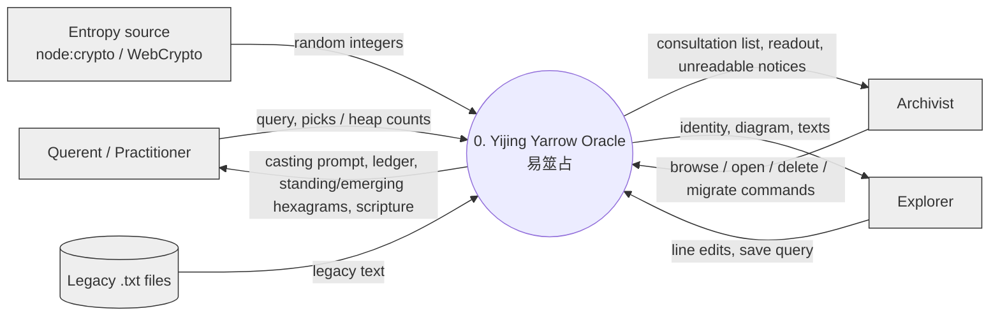
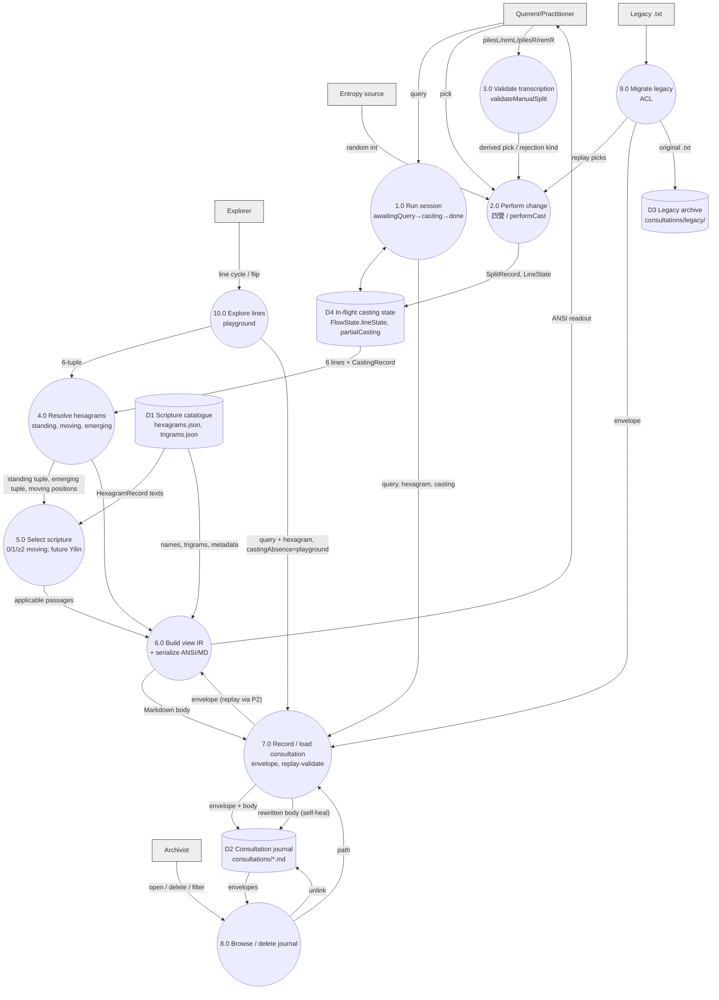

# Survey 09 — Domain Discovery (Ubiquitous Language, EventStorming, Strategic/Tactical DDD, DFD)

Scope: read-only discovery over `CONTEXT.md`, `CLAUDE.md`/`AGENTS.md`, `docs/adr/*`, `docs/agents/*`, `domain/core/src/**` (types, foundation, algorithm), plus targeted reads of `domain/consultation-file`, `domain/consultation-view`, `cli/casting-ui/src/viewer-flow.ts`, `cli/history-ui`, `cli/playground-ui`. Nothing under `consultations/` was opened. Citations are `path:line`.

Overall verdict: the code already has a well-formed **pure oracle kernel** (`performCast` over a phase-typed `LineState`, single-sourced invariants, a replay rule) and a well-formed **persistence envelope** (`ConsultationEnvelope` + `CastingPresence` union). What's missing is mostly _naming and seams_: there is no explicit `Consultation` aggregate type, no identity apart from a filename timestamp, no domain events (state transitions are reducer actions in a CLI package), the scripture-selection rule is buried in a presentation builder, and "Hexagram" names two different types.

---

## 1. Ubiquitous Language glossary

Legend: **[canon]** = term the code/docs treat as canonical; **[syn]** = synonym in use; **[hom]** = homonym (same word, different meaning); **[gap]** = concept present in code but unnamed in `CONTEXT.md`.

### 1.1 Oracle / casting vocabulary

| Term                                     | Chinese                    | Definition                                                           | Where it lives                                                                                                                              | Notes                                                                                                                                                                                                                          |
| ---------------------------------------- | -------------------------- | -------------------------------------------------------------------- | ------------------------------------------------------------------------------------------------------------------------------------------- | ------------------------------------------------------------------------------------------------------------------------------------------------------------------------------------------------------------------------------ |
| Yarrow-stalk divination (the method)     | 大衍筮法 / 筮              | The procedure the app performs; the app does 筮, the user does 占    | `docs/adr/0014-product-identity.md:15-16,26-32`                                                                                             | Load-bearing boundary: app never interprets.                                                                                                                                                                                   |
| Interpretation                           | 占                         | The user's work of meaning-making; explicitly out of scope           | `docs/adr/0014-product-identity.md:17,26-35`                                                                                                | Must stay out of the domain model.                                                                                                                                                                                             |
| Principal number of derivation           | 大衍之數五十，其用四十有九 | 50 stalks, 49 used                                                   | `domain/core/src/index.ts:51-57` (`principalNumberOfDerivation`, `stalksBeforeParting`)                                                     | One stalk set aside forever; not modelled as a concept.                                                                                                                                                                        |
| Stalk                                    | 策/蓍                      | A unit counted; modelled as `number` ids 1..49 in arrays             | `domain/core/src/index.ts:53-57`                                                                                                            | Stalks carry identity (ids) but nothing uses it — only counts matter.                                                                                                                                                          |
| Four Operations                          | 四營                       | One round: part → suspend one → count by fours → set aside remainder | `domain/core/src/index.ts:154-173` (`fourOperations`)                                                                                       |                                                                                                                                                                                                                                |
| Part the stalks                          | 分而為二以象兩 (一營)      | Divide unparted stalks into left/right heaps at index `pick`         | `domain/core/src/index.ts:59-72` (`partTheStalks`)                                                                                          |                                                                                                                                                                                                                                |
| Suspend one                              | 掛一以象參 (二營)          | Take one stalk from the right heap                                   | `domain/core/src/index.ts:74-88`                                                                                                            | Code says "suspend"/"held"; `DerivedSplit.held: 1` (`casting-derivation.ts:97`).                                                                                                                                               |
| Count by fours                           | 揲之以四以象四時 (三營)    | Sort each heap into groups of four                                   | `domain/core/src/index.ts:90-106`                                                                                                           |                                                                                                                                                                                                                                |
| Set aside remainder                      | 歸奇於扐以象閏 (四營)      | Remove last group (1..4) of each heap                                | `domain/core/src/index.ts:108-126`                                                                                                          |                                                                                                                                                                                                                                |
| Cast / Round / Change / Division / Split | 變 (一變)                  | One run of the four operations; 3 per line                           | `FourOperationsResult` `domain/core/src/types.ts:65-68`; `LineState.phase` `types.ts:222-245`; "division (一變)" `casting-derivation.ts:76` | **[syn] heavy:** "cast", "round", "division", "split", "change" all mean 一變. `castIndex` (`viewer-flow.ts`), `rounds` (`types.ts:193`), "Cast C/3" (UI), "division" (`types.ts:98-101`). Pick one: _Change_ (變) or _Round_. |
| Pick                                     | —                          | The index at which the stalks are parted = left-heap size            | `SplitRecord.pick` `types.ts:97`; `partStalksAtIndex` `index.ts:62`                                                                         | **[syn]** pick / partStalksAtIndex / split / "parting position".                                                                                                                                                               |
| Split record                             | —                          | `{ pick, recordedMax }` — the persisted fact of one division         | `types.ts:89-97`                                                                                                                            | **[hom]** "split" = the act (part), the record, the manual "SPLIT placeholder", and a legacy table vintage ("SPLIT vintage", `legacy-converter.ts:162`).                                                                       |
| Recorded max                             | —                          | `unparted − 1` (reserves 掛一); persisted, NOT a legal pick          | `casting-derivation.ts:21-22`; `types.ts:89-97`; `docs/agents/casting-invariants.md:15-20`                                                  | Renamed from `max` (ADR-0008:25-28).                                                                                                                                                                                           |
| Selectable pick ceiling                  | —                          | `recordedMax − 1`; highest legal pick                                | `casting-derivation.ts:44-45`                                                                                                               | Two "maxes" are a known confusion hotspot.                                                                                                                                                                                     |
| Stalk count                              | —                          | `recordedMax + 1`                                                    | `casting-derivation.ts:55`                                                                                                                  |                                                                                                                                                                                                                                |
| Unparted stalks                          | —                          | Stalks entering a round (49 → 40/44 → 32/36/40 …)                    | `FourOperationsResult.unpartedStalks` `types.ts:66`; `LineState.unparted`                                                                   |                                                                                                                                                                                                                                |
| Suspended (set-aside pile)               | 扐                         | Accumulated suspended + remainders                                   | `suspendedFromNextRound` `types.ts:67`                                                                                                      | Odd name ("from next round"); really "set aside so far".                                                                                                                                                                       |
| Remainder                                | 奇                         | 1..4 per heap; never 0                                               | `neverZeroMod4` `casting-derivation.ts:10`                                                                                                  | Invariant: never-zero remainder.                                                                                                                                                                                               |
| Piles (of four)                          | —                          | Complete groups of four in a heap                                    | `DerivedSplit.leftPiles/rightPiles` `casting-derivation.ts:87-95`; manual `pilesL/pilesR` `manual-validation.ts:46-48`                      |                                                                                                                                                                                                                                |
| Suspended sum                            | —                          | `1 + remL + remR` ∈ {5,9} (cast 1) or {4,8} (casts 2/3)              | `manual-validation.ts:81-88`                                                                                                                |                                                                                                                                                                                                                                |
| Conservation                             | —                          | `4·pL + rL + 4·pR + rR + 1 = unparted`                               | `manual-validation.ts:68-80`; `casting-derivation.ts:111-114`                                                                               |                                                                                                                                                                                                                                |
| Line                                     | 爻                         | Value 6/7/8/9 produced by three changes (三變成爻)                   | `types.ts:1`; resolved at `index.ts:267-279` (`unpartedStalks.length / 4`)                                                                  |                                                                                                                                                                                                                                |
| Line value names                         | 老陰/少陽/少陰/老陽        | 6 old yin, 7 young yang, 8 young yin, 9 old yang                     | `line-semantics.ts:9-13`                                                                                                                    |                                                                                                                                                                                                                                |
| Moving line                              | 動爻 / 變爻                | A line of value 6 or 9 that transforms                               | `isMovingLine` `line-semantics.ts:21-23`                                                                                                    | **[syn]** moving / old / changing (CLAUDE.md "old yin / moving yin"). Code canon: _moving_.                                                                                                                                    |
| Static line                              | —                          | 7 or 8                                                               | `line-semantics.ts:9-13`                                                                                                                    | Also "young".                                                                                                                                                                                                                  |
| Polarity                                 | 陰陽                       | yang (7,9) vs yin (6,8)                                              | `polarityOf` `line-semantics.ts:46-48`                                                                                                      |                                                                                                                                                                                                                                |
| Line position / index                    | 初二三四五上               | 1..6 bottom-first; `LineIndex` 0..5                                  | `types.ts:27-44`; labels `consultation-view/src/vocabulary.ts:15-34`                                                                        | Bottom-first in memory vs top-first on disk/display (ADR-0008:39-43).                                                                                                                                                          |
| Line casting                             | 三變                       | Three split records for one line                                     | `LineCasting` `types.ts:98-99`                                                                                                              |                                                                                                                                                                                                                                |
| Casting record                           | 十有八變                   | 18 split records, line 1 first                                       | `CastingRecord` `types.ts:100-109`                                                                                                          | **[hom]** "casting" = the act (casting flow, `mode: 'casting'`), the record (`casting:` YAML key), the UI tab ("Casting"), and the IR section (`kind: 'casting'`).                                                             |
| Partial casting record                   | —                          | Casting with `null` cells in flight                                  | `types.ts:162-189`                                                                                                                          |                                                                                                                                                                                                                                |
| Line state                               | —                          | Phase-discriminated per-line algorithm state                         | `types.ts:214-253`                                                                                                                          | Well-formed value object / state machine.                                                                                                                                                                                      |
| Hexagram (domain tuple)                  | 卦                         | Six lines bottom-first `[Line×6]`                                    | `types.ts:13`                                                                                                                               | **[hom]** `foundation.ts:9` exports a _different_ `Hexagram` = polarity-key string `${Trigram}${Trigram}`.                                                                                                                     |
| Standing hexagram                        | 本卦                       | The hexagram as cast (with moving lines)                             | IR `role: 'standing'` `consultation-view/src/ir.ts:107`; tab name                                                                           | **[syn]** in literature: primary/original/present/本卦. Code uses only _standing_ (no `primary`/`original` in domain src). The tuple type is just `Hexagram`; "standing" is a presentation role, not a type.                   |
| Emerging hexagram                        | 之卦 / 變卦                | Moving lines collapsed 6→7, 9→8                                      | `getEmergingHexagram` `line-semantics.ts:69-84`                                                                                             | **[syn]** emerging / changed / relating / resulting / future. Code canon: _emerging_. Note `getEmergingHexagram` normalises _all_ lines to static values — the emerging hexagram carries no moving lines.                      |
| Transformation                           | —                          | Side-by-side standing→emerging view                                  | IR `kind: 'transformation'` `ir.ts:92`; `build-view.ts:286-305`                                                                             | Presentation term only; null body when static.                                                                                                                                                                                 |
| Hexagram key                             | —                          | `H` + 6 digits, `1`=yang `2`=yin, bottom-first                       | `foundation.ts:221`; `getters.ts:9-25`                                                                                                      | The real identity of a hexagram _figure_ (moving-ness erased).                                                                                                                                                                 |
| King Wen order                           | 文王卦序                   | 1..64 canonical numbering                                            | `foundation.ts:302-309`                                                                                                                     | **[hom]** `trigram.ts:6` `WEN_WANG_ORDER` = 後天八卦 trigram arrangement, not hexagram sequence.                                                                                                                               |
| Fuxi order                               | 伏羲卦序                   | Binary ordering                                                      | `foundation.ts:311`; `trigram.ts:2`                                                                                                         |                                                                                                                                                                                                                                |
| Trigram                                  | 經卦 / 下卦 / 上卦         | 3-line figure; lower/upper                                           | `trigram.ts:22-34`; `hexagram.ts:35`                                                                                                        |                                                                                                                                                                                                                                |
| Hexagram record                          | —                          | Key, Name, Metadata, Text for one of 64                              | `GenericHexagramRecord` `models/hexagram.ts:113-118`                                                                                        |                                                                                                                                                                                                                                |
| Scripture                                | 卦辭 / 爻辭 (《周易》經)   | Judgment text + six line texts                                       | `HexagramTextScripture` `hexagram.ts:73-78`                                                                                                 |                                                                                                                                                                                                                                |
| Exegesis                                 | 彖辭 / 象傳 (《易傳》)     | Judgment commentary + Great/Small Image                              | `HexagramTextExegesis` `hexagram.ts:80-90`                                                                                                  |                                                                                                                                                                                                                                |
| Translation / Text variant               | —                          | Chinese Traditional, Chinese Simplified, Wilhelm-Baynes, Legge       | `hexagram.ts:99-108`; IR `TextVariant.language` `build-view.ts:100-139`                                                                     |                                                                                                                                                                                                                                |
| Line texts                               | —                          | `L1..L6` only                                                        | `foundation.ts:1248-1255`                                                                                                                   | **[gap]** No 用九 / 用六 (the all-moving texts of 乾/坤).                                                                                                                                                                      |

### 1.2 Consultation / journal vocabulary

| Term                                                     | Definition                                                                                             | Where                                                             | Notes                                                                                                                                                                                                                                                   |
| -------------------------------------------------------- | ------------------------------------------------------------------------------------------------------ | ----------------------------------------------------------------- | ------------------------------------------------------------------------------------------------------------------------------------------------------------------------------------------------------------------------------------------------------- |
| Consultation                                             | Query + casting + resulting hexagram(s), saved as one file; canonical user noun                        | `CONTEXT.md:15-22`                                                | No `Consultation` type exists; closest is `ConsultationEnvelope` `frontmatter.ts:109`. Avoid "reading", "entry", "session" (`CONTEXT.md:21-22`) — but `ReadingsPanel` (`cli/playground-ui/src/readings-panel.tsx:1`) and `HistoryEntry` still use them. |
| Query                                                    | The divination question                                                                                | `CONTEXT.md:30-36`                                                | **[syn]** `question` param in `cli/casting-ui/src/log-and-save.ts:14,19,23,27` — violates CONTEXT.md. **[hom]** vs history _filter_.                                                                                                                    |
| Envelope                                                 | YAML frontmatter: schemaVersion, timestamp, query, hexagram, casting / castingAbsence                  | `frontmatter.ts:30,85-125`; ADR-0008                              | The canonical persisted model.                                                                                                                                                                                                                          |
| Casting presence / absence reason                        | `{casting, null}` xor `{null, reason}`; reasons `legacy-no-table`, `legacy-unreplayable`, `playground` | `frontmatter.ts:105-107`; `types.ts:111-138`                      | Lives in `core/types` though it is a journal concept.                                                                                                                                                                                                   |
| Body                                                     | Decorative Markdown re-rendered on load                                                                | ADR-0008:6-8; `file.ts:55-70`                                     |                                                                                                                                                                                                                                                         |
| Self-heal (body refreshed)                               | Re-render & rewrite when body drifts                                                                   | `cli/history-ui/src/history-app.tsx:18-36,287`                    |                                                                                                                                                                                                                                                         |
| Unreadable file                                          | `.md` that failed to parse; not a Consultation                                                         | `CONTEXT.md:24-28`; `ParseFailureReason` `frontmatter.ts:115-122` |                                                                                                                                                                                                                                                         |
| Replay validation                                        | Re-run 18 picks; must reproduce stored hexagram                                                        | `casting-replay.ts:22-60`                                         | "prove, don't trust".                                                                                                                                                                                                                                   |
| Legacy `.txt` (Shape A / Shape B; HEAP / SPLIT vintages) | Pre-Markdown format and its migration                                                                  | `legacy-converter.ts:20-60,108,135-168`; ADR-0008:50-58           |                                                                                                                                                                                                                                                         |
| Timestamp                                                | ISO 8601 with offset; also filename                                                                    | `file.ts:79-109`; `utils-timestamp.ts:9,18`                       | De-facto identity.                                                                                                                                                                                                                                      |
| Consultations dir                                        | Repository of files                                                                                    | `file.ts:36-46`; ADR-0020                                         |                                                                                                                                                                                                                                                         |
| Provenance (interactive/random/manual/loaded)            | Readout display property, _not_ stored                                                                 | `CONTEXT.md:86-90`; ADR-0011:50-60                                |                                                                                                                                                                                                                                                         |

### 1.3 Flow / UI vocabulary (leaks into domain discussions)

| Term                   | Definition                                                       | Where                                                                          |
| ---------------------- | ---------------------------------------------------------------- | ------------------------------------------------------------------------------ |
| Viewer                 | Casting orchestrator owning the flow state machine               | `CONTEXT.md:45-51`; `viewer-flow.ts:33-34`                                     |
| Flow kind              | `interactive` / `random` / `manual`                              | `viewer-flow.ts:33`                                                            |
| Flow mode              | `awaitingQuery → casting → computing → done`                     | `viewer-flow.ts:34`; ADR-0009:12-29                                            |
| Casting plan           | Pre-generated random consultation played back as animation       | `viewer-flow.ts:23,65,76`                                                      |
| Line rewound           | Manual two-line undo                                             | `viewer-flow.ts:96-102`; ADR-0011:41-48                                        |
| Readout                | Display of one Consultation                                      | `CONTEXT.md:38-43`                                                             |
| Playground             | 4-state line explorer; saves with `castingAbsence: 'playground'` | `cli/playground-ui/src/playground-app.tsx:283-293`; `line-semantics.ts:86-111` |
| Consultation view (IR) | Medium-neutral section list                                      | `consultation-view/src/build-view.ts:275-342`; ADR-0018                        |

### 1.4 Synonym/homonym flags (summary)

- **standing / primary / original / present / 本卦** — code uses _standing_ only; literature uses the rest. Recommend: _Standing Hexagram (本卦)_; avoid others.
- **emerging / changed / relating / resulting / future / 之卦** — code uses _emerging_. Recommend: _Emerging Hexagram (之卦)_.
- **moving / changing / old** lines — code canon _moving_; _old_ is a value-name (old yin = 6), not a synonym of moving in the strict sense (old ⇒ moving).
- **pick / split / part / partStalksAtIndex / division / cast / round / change** — two concepts are smeared: the _act_ (a Change 變 performed by parting at a pick) and the _record_ (`SplitRecord`). Recommend: `Change` (act/event), `ChangeRecord` or keep `SplitRecord` (fact), `PartingPoint`/`pick` (value).
- **casting** — act, record, flow phase, UI tab, IR section, YAML key. Recommend: _Casting_ = the act/process; _CastingRecord_ = the 18-change log.
- **Hexagram** — `types.ts:13` (Line tuple, carries moving info) vs `foundation.ts:9` (polarity key string, no moving info). Recommend: `Hexagram` (figure, 64 values, keyed `HexagramKey`) vs `LineSet`/`CastResult` (4,096 values, 6-tuple of 6/7/8/9).
- **Wen Wang order** — hexagram sequence (`foundation.ts:302`) vs trigram later-heaven arrangement (`trigram.ts:6`).
- **query vs question vs filter** — `log-and-save.ts:14` still says `question`.
- **reading** — banned for Consultation in `CONTEXT.md:21-22`, but used in playground ("readings panel") and literature for the scripture _text_. Free it up for "scripture reading" or ban it consistently.
- **Viewer vs Readout** — already resolved in `CONTEXT.md:38-51`; keep.

---

## 2. Big Picture EventStorming timeline

Actors: **Querent** (the human consulting), **Practitioner** (querent casting with physical stalks — manual flow), **Oracle RNG** (system actor, `node:crypto`), **Archivist** (the user browsing/deleting/migrating), **Explorer** (playground user).

Timeline (left→right). Format: **Event** ← _Command_ — Actor · Policy · Read model · Hotspot.

### Phase A — Opening the consultation

1. **ConsultationOpened** (flow started) ← _StartConsultation(flowKind)_ — Querent · Policy: interactive env policy (non-TTY → plain; `NO_COLOR`/CI → typed input; manual/history refuse non-TTY) (ADR-0010; CLAUDE.md) · RM: empty Casting ledger with `·` cells · Hotspot: flow kind / input mode is an _adapter_ concern, but `FlowKind` lives in the domain-ish reducer (`viewer-flow.ts:33`).
2. **QueryPosed** ← _PoseQuery(text)_ — Querent · Policy: query is required before casting (`awaitingQuery` gate, ADR-0009:18-19); empty allowed in legacy (`legacy-converter.ts:71-76`, "`QUERY_NOT_PROVIDED`") · RM: Query box · Hotspot: does the query belong to the oracle at all? The pure oracle never needs it. Is an empty query valid?

### Phase B — Casting (repeated 6 lines × 3 changes)

3. **StalksParted** (分而為二) ← _PartStalks(pick)_ — Querent (slider SPACE / typed / Inquirer), Practitioner (derived from four counts), Oracle RNG · Policy: _clamp pick to selectablePickMax_ (pre-clamp in each flow; `random-casting.ts:28-31`), _assertSelectablePick_ final authority (`casting-derivation.ts:63-73`, `index.ts:230`) · RM: casting prompt (Stalks / Left Heap / Right Heap) · Hotspot: the two maxes; RNG's uniform-split-point model shifts line distribution (ADR-0006:122-189).
   - Manual sub-flow: **HeapCountsTranscribed** ← _TranscribeCounts(pilesL, remL, pilesR, remR)_ — Practitioner · Policy: validation tiers incomplete → zero-remainder → conservation → suspended-sum (`manual-validation.ts:45-97`) · RM: flow diagram + `MISSING STALKS` gauge · Hotspot: the ordering is load-bearing (ADR-0011:97-100). Rejected counts emit **TranscriptionRejected(kind)**.
4. **OneStalkSuspended** (掛一) — internal, automatic · Policy: always exactly 1 from right · Hotspot: none; fold into 5.
5. **StalksCountedByFours** (揲之以四) — internal · fold into 6.
6. **RemainderSetAside** (歸奇於扐) — internal · Policy: remainder ∈ 1..4 never 0 · RM: `DerivedSplit` reconstruction (`casting-derivation.ts:115-136`).
   - For Big Picture, 3–6 collapse into one aggregate event: **ChangeCompleted (變)** carrying `{lineNo, changeNo, pick, recordedMax}` = exactly a `SplitRecord` plus coordinates. Code analogue: reducer action `splitCommitted` (`viewer-flow.ts:82`), `performCast` (`index.ts:211-282`).
7. **LineDetermined (爻)** — automatic after third change · Policy: line = remaining stalks / 4 (`index.ts:267-279`); policy "reset LineState to initial and advance lineIndex" (`viewer-flow.ts:184-200`) · RM: ledger row filled; auto-follow scroll · Hotspot: none.
8. **LineRewound** ← _RewindLine_ — Practitioner (Ctrl+R, manual only) · Policy: two-line lookback window (ADR-0011:41-48) · RM: ledger row cleared · Hotspot: is undo a domain capability (should the event log support retraction?) or a UI convenience? Only manual has it.
9. **RandomCastingPlanned** ← _GenerateRandomConsultation_ — Oracle RNG · Policy: plan generated _up front_ in the imperative shell, then **played back** as synthetic ChangeCompleted events; **PlaybackSkipped** fills the rest (`viewer-flow.ts:76,87,291+`) · Hotspot: for random flow, the "events" are a replay of an already-decided result — event sourcing must not double-count; is randomness an Oracle port (`RandomSource`)?

### Phase C — Resolution

10. **HexagramFormed** (十有八變而成卦) — automatic after 6th LineDetermined · Policy: assert 6 lines (`random-casting.ts:126-127`) · RM: Standing diagram · Hotspot: name — "Standing Hexagram" vs the 6/7/8/9 tuple (4,096 states) vs the 64-figure.
11. **MovingLinesIdentified** — automatic · Policy: `movingLineIndices` (`line-semantics.ts:29-35`) · RM: ○/✕ glyphs (`vocabulary.ts:8-13`).
12. **EmergingHexagramDerived** — automatic, only if ≥1 moving line · Policy: emerging gate (`build-view.ts:281,324`) · RM: Transformation tab, Emerging tab · Hotspot: when 0 moving lines, is there "no emerging hexagram" or "emerging = standing"? Code: no emerging section; `getEmergingHexagram` would return the standing figure.
13. **ScriptureResolved** — automatic · Policy: _which text applies_: 0 moving → hexagram judgment (卦辭) + Great Image; 1 moving → that line's text + Small Image; ≥2 moving → **no text** ("No available reference scripture or exegesis for multiple moving lines", `cli/readout/src/serialize-ansi.ts:237-242`, `cli/text-grid/src/serialize-markdown.ts:159-164`); emerging hexagram judgment always shown when moving (`build-view.ts:324-339`). Policy is currently embedded in `linesSection` (`build-view.ts:145-170`), i.e. in the _presentation_ IR · Hotspot: **biggest domain gap** — multi-moving-line rule (Zhu Xi 朱熹《易學啟蒙》 rules), 用九/用六 for 乾/坤 all-moving, and Yilin 焦氏易林 lookup (standing→emerging, 4,096 verses) belong here.
14. **ReadingDelivered / ResponseReceived (受命)** — terminal; the app stops here (ADR-0014:26-35) · RM: unlocked Readout (`mode: 'done'`).

### Phase D — Recording

15. **ConsultationRecorded** ← _RecordConsultation(query, hexagram, casting | absenceReason)_ — system (auto on `computing`) · Policy: never persist derived data (ADR-0008:44-48); casting XOR absence (`frontmatter.ts:105-107`); no provenance field (ADR-0011:50-60); filename = timestamp (`file.ts:79-109`) · RM: saved-path footer · Hotspot: save happens in `computing` (side effect) — failure emits **ConsultationRecordingFailed** (`computeFailed`, `viewer-flow.ts:93`). Body rendering is done by the caller and injected (`file.ts:61-70`) — a persistence adapter concern masquerading as a domain parameter.
16. **PlaygroundHexagramSaved** ← _SaveExploration(query, lines)_ — Explorer · Policy: `castingAbsence: 'playground'` (`playground-app.tsx:283-293`) · Hotspot: is a playground save a Consultation at all? It never performed 筮.

### Phase E — Journal lifecycle

17. **JournalScanned** ← _BrowseJournal_ — Archivist · Policy: newest-first by `envelope.timestamp` (`history-scan.ts:59`); unreadable files counted separately · RM: history list (two-line rows), `40 consultations · 2 unreadable`.
18. **ConsultationReopened** ← _OpenConsultation(path)_ — Archivist · Policy: strict `schemaVersion` equal; replay-validate casting; failures → **ConsultationFoundUnreadable(reason)** (`frontmatter.ts:164-224`) · RM: Readout ("Consultation · loaded <when>").
19. **ConsultationBodyRefreshed** — automatic on reopen if body drifts · Policy: re-render & byte-compare & rewrite (`history-app.tsx:18-36`) · RM: "✓ Body refreshed; data unchanged." · Hotspot: a read path that writes — in a hexagonal rebuild this is a _projection rebuild_, not a domain event.
20. **ConsultationDeleted** ← _DeleteConsultation(path)_ + confirmation — Archivist · Policy: Y/N modal; permanent unlink (`history-app.tsx:209-214`) · Hotspot: no soft delete/trash; IndexedDB/REST will need an identity other than file path.
21. **LegacyConsultationMigrated** ← _ConvertLegacy_ — Archivist (CLI `--convert-legacy`) · Policy: Shape A → replay-validate → keep casting or tag `legacy-unreplayable`; Shape B → `legacy-no-table`; move original to `consultations/legacy/` (`legacy-converter.ts:30-60,108`; ADR-0008:50-58) · Hotspot: one-shot ACL; the `.txt` parsing regexes are a foreign Published Language.

### Phase F — Exploration (off the main timeline)

22. **LineCycled / LinePolarityFlipped** ← _CycleLine(pos, dir)_ / _FlipLine(pos)_ — Explorer · Policy: 7→9→8→6 cycle (`line-semantics.ts:86-111`), flip 7↔8, 9↔6 (`line-semantics.ts:56-67`) · RM: playground identity + diagram subset of the IR (ADR-0018:66-70) · Hotspot: the playground is the natural UI for the "stateless over all 4,096 permutations" oracle.

---

## 3. Strategic design

### 3.1 Proposed bounded contexts

| #   | Context                                        | Responsibility                                                                                                                                         | Current home                                                                                                                                           | Classification                                                                                                    |
| --- | ---------------------------------------------- | ------------------------------------------------------------------------------------------------------------------------------------------------------ | ------------------------------------------------------------------------------------------------------------------------------------------------------ | ----------------------------------------------------------------------------------------------------------------- |
| BC1 | **Oracle (Casting)** — 筮                      | Four operations, line state machine, casting record, line semantics, emerging derivation, replay, manual-transcription validation, RNG port            | `domain/core/src/index.ts`, `casting-derivation.ts`, `line-semantics.ts`, `manual-validation.ts`, `random-casting.ts`, `sample-casting.ts`, `types.ts` | **Core**                                                                                                          |
| BC2 | **Scripture Reference Catalogue** — 易         | 64 hexagram + 8 trigram records; texts per translation; _text-selection rule_ (which passages apply to a standing→emerging pair); future Yilin         | `domain/core/src/models/*`, `getters.ts`; selection rule currently in `consultation-view/src/build-view.ts:114-170`                                    | **Core** (selection rule) / **Supporting** (static corpus)                                                        |
| BC3 | **Consultation Journal**                       | Consultation aggregate lifecycle: record, reopen, list, delete, migrate; envelope schema; absence reasons; repository ports (Markdown/Typst/IndexedDB) | `domain/consultation-file/*`, `cli/history-ui/src/history-scan.ts`, history delete in `history-app.tsx`                                                | **Supporting**                                                                                                    |
| BC4 | **Presentation (Consultation View)**           | Medium-neutral IR (sections, order, glyph vocabulary, emerging gate) + medium serializers (ANSI, Markdown, future Typst/HTML/HAL)                      | `domain/consultation-view`, `domain/text-layout`, `cli/text-grid`, `cli/readout`                                                                       | **Supporting** (IR) / **Generic** (text-layout, ANSI chrome)                                                      |
| BC5 | **Consultation Session (Divination Flow)**     | The application-level process: awaitingQuery → casting → computing → done; flow kinds; rewind; random playback                                         | `cli/casting-ui/src/viewer-flow.ts`                                                                                                                    | **Supporting** — this is an _application service / process manager_, not a domain; today it sits in a CLI package |
| BC6 | **Playground / Exploration**                   | Free editing of a 6/7/8/9 tuple to explore the oracle's output space                                                                                   | `cli/playground-ui/*` (+ `line-semantics.ts` cycle)                                                                                                    | **Supporting** (thin)                                                                                             |
| —   | Terminal UI shell, banner, keymaps, crypto RNG | Generic subdomains                                                                                                                                     | `cli/viewer-core`, `crypto-random.ts`                                                                                                                  | **Generic**                                                                                                       |

Notes:

- The _Oracle_ and _Scripture_ are separate because one is a deterministic algorithm over stalks and the other is a corpus + selection rule keyed by hexagram figure. The seam already exists: `getHexagramRecord(hexagram)` (`getters.ts:31-35`). The Oracle's output (`Hexagram` 6/7/8/9 tuple) is the Published Language between them.
- **Text selection** (BC2) is today in BC4's builder. It is domain knowledge (which passage the oracle points at), not presentation; ADR-0019 already argued "presentation-of-domain is domain", but this specific rule should move one layer further down into the catalogue/oracle so a REST adapter can expose it without the IR.
- The "functional core" requirement (stateless over all 4,096 permutations) is BC1+BC2 combined as a pure function `consult(lines) → { standing, emerging?, movingPositions, applicableTexts[], yilinVerse? }`.

### 3.2 Context map

```
                 ┌──────────────────────────────┐
                 │  BC1 Oracle (Core)           │
                 │  Published Language:         │
                 │   Line, Hexagram(6-tuple),   │
                 │   SplitRecord, CastingRecord │
                 └──┬─────────┬──────────┬──────┘
         Shared     │         │ U/D      │ U/D (Conformist)
         Kernel(*)  │         │ C/S      │
   ┌────────────────▼───┐  ┌──▼───────────────┐  ┌───────────────────────┐
   │ BC2 Scripture      │  │ BC3 Journal       │  │ BC6 Playground        │
   │ Catalogue          │  │ (Supporting)      │  │ (Conformist to BC1 PL)│
   │ OHS: lookup by     │  │ ACL ◄── Legacy    │  └───────────────────────┘
   │ HexagramKey /      │  │  .txt (foreign PL)│
   │ (standing,emerging)│  │ Repo ports: md,   │
   └────────┬───────────┘  │ typst, indexeddb  │
            │ U/D C/S      └──┬────────────────┘
            │                 │ U/D (Customer/Supplier: body injected)
         ┌──▼─────────────────▼──────┐
         │ BC4 Presentation (IR)     │──► serializers: ANSI, Markdown, Typst, HTML/HAL
         └──────────▲────────────────┘
                    │
         ┌──────────┴────────────────┐
         │ BC5 Session / Flow        │ orchestrates BC1 → BC2 → BC3 (+ BC4 for display)
         └───────────────────────────┘
```

- **BC1 ↔ BC2: Shared Kernel (\*) today** — both live in `@hexagram/core`, sharing `Line`/`Hexagram`/`HexagramKey`. Proposed: BC1 _upstream_ with a **Published Language** (`Hexagram` tuple → `HexagramKey`), BC2 _Open Host Service_ (`getHexagramRecord`, future `getYilinVerse(standingKey, emergingKey)`). Keep a tiny shared kernel only for `Line`/`HexagramKey`.
- **BC1 → BC3: Customer/Supplier**; BC3 persists `CastingRecord` and calls BC1's replay (`casting-replay.ts:1` imports `makeLineGenerator`) — Journal _conforms_ to the Oracle's record format. `CastingAbsenceReason` currently lives in BC1 (`types.ts:111-138`) — it is a Journal concept and should move.
- **Legacy `.txt` → BC3: Anti-Corruption Layer** — `convertLegacyTxt` (`legacy-converter.ts:30`) with HEAP/SPLIT vintages and Shape A/B. Already a proper ACL; keep it one-way and isolated.
- **BC3 ↔ BC4: Customer/Supplier with inversion** — Journal receives an opaque body string from BC4's Markdown serializer (`file.ts:61-70`, ADR-0022). In a hexagonal rebuild, the Markdown _adapter_ of the Journal repository should call the BC4 serializer; the domain-side save port should not take `body` at all.
- **BC5 → BC1/BC2/BC3/BC4: Process manager (orchestrator)** — Viewer reducer drives `performCast`, then save, then IR.
- **BC6 → BC1: Conformist** (uses line semantics + IR subset, ADR-0018:66-70) and → BC3 via the `playground` absence reason.
- **Ports & Adapters**: driving adapters CLI (Ink + plain), HATEOAS REST, PWA; driven adapters: RandomSource (`node:crypto` / Web Crypto), ConsultationRepository (Markdown fs / Typst / IndexedDB), Clock (timestamp), ScriptureCatalogue (JSON).

---

## 4. Tactical design per context

### BC1 Oracle

| Element                                    | Kind                                                                                                                                                                       | Status in code                                                                                                                                                                                                                                                                                                                              |
| ------------------------------------------ | -------------------------------------------------------------------------------------------------------------------------------------------------------------------------- | ------------------------------------------------------------------------------------------------------------------------------------------------------------------------------------------------------------------------------------------------------------------------------------------------------------------------------------------- |
| `Line` (6\|7\|8\|9)                        | Value object                                                                                                                                                               | Well-formed (`types.ts:1-11`), guard + assertion.                                                                                                                                                                                                                                                                                           |
| `LinePolarity`, moving/static              | VO / derived property                                                                                                                                                      | Well-formed (`line-semantics.ts`).                                                                                                                                                                                                                                                                                                          |
| `LineIndex` / position 1..6                | VO                                                                                                                                                                         | Well-formed (`types.ts:33-44`); orientation flip single-homed (`types.ts:46-63`).                                                                                                                                                                                                                                                           |
| `Hexagram` (6-tuple)                       | VO (4,096-valued)                                                                                                                                                          | Well-formed; but name collides with `foundation.ts:9`. Rename candidate: `CastLines`/`LineSet`.                                                                                                                                                                                                                                             |
| `SplitRecord {pick, recordedMax}`          | VO (fact of one change)                                                                                                                                                    | Well-formed; invariant pick ≤ recordedMax−1 enforced by `performCast`, not by construction. Missing smart constructor.                                                                                                                                                                                                                      |
| `LineCasting`, `CastingRecord`             | VO (ordered log)                                                                                                                                                           | Well-formed shape; **is effectively the event log** of a casting (replayable, ADR-0006:20-23).                                                                                                                                                                                                                                              |
| `LineState` (phase union)                  | Entity-ish state / state machine VO                                                                                                                                        | Excellent: phase-typed, `AdvanceableLineState` makes over-stepping a compile error (`types.ts:214-253`).                                                                                                                                                                                                                                    |
| `HexagramCasting` (6 lines in progress)    | **Aggregate (missing)**                                                                                                                                                    | Today the 6-line progression (lineIndex, castIndex, completedLines, partialCasting) lives in `FlowState` in a CLI package (`viewer-flow.ts:36-68`). Proposed aggregate root `Casting` with invariants: exactly 18 changes, in order; each change obeys selectable-pick; line resolved after 3; hexagram after 6; rewind only within window. |
| `performCast`                              | Domain service / pure transition                                                                                                                                           | Well-formed (`index.ts:211-282`).                                                                                                                                                                                                                                                                                                           |
| `fourOperations` pipeline                  | Domain service                                                                                                                                                             | Well-formed (`index.ts:162-173`).                                                                                                                                                                                                                                                                                                           |
| `deriveSplit`                              | Domain service (reconstruction, tolerant)                                                                                                                                  | Well-formed (`casting-derivation.ts:115-136`); explicitly non-throwing.                                                                                                                                                                                                                                                                     |
| `castingReplaysTo`                         | Domain service                                                                                                                                                             | Lives in BC3 (`casting-replay.ts:22`) but is pure Oracle knowledge — should move to BC1 (`replay(casting) → Hexagram`).                                                                                                                                                                                                                     |
| `validateManualSplit`                      | Domain policy (specification)                                                                                                                                              | Well-formed (`manual-validation.ts:45-97`).                                                                                                                                                                                                                                                                                                 |
| `getEmergingHexagram`, `movingLineIndices` | Domain services                                                                                                                                                            | Well-formed (`line-semantics.ts`).                                                                                                                                                                                                                                                                                                          |
| `sampleCastingFor(hexagram)`               | Domain service (inverse)                                                                                                                                                   | Present (`sample-casting.ts:1-30`), test/doc helper.                                                                                                                                                                                                                                                                                        |
| RandomSource                               | **Port (missing as a named port)**                                                                                                                                         | `random-casting.ts:1,28-31` imports `node:crypto` directly — blocks PWA/browser.                                                                                                                                                                                                                                                            |
| Invariants                                 | never-zero remainder; recordedMax = unparted−1; selectable = recordedMax−1; conservation; suspended-sum ∈ {5,9}/{4,8}; line = stalks/4; 49 stalks; 3 changes/line; 6 lines | All present, single-sourced (`docs/agents/casting-invariants.md`).                                                                                                                                                                                                                                                                          |
| Domain events                              | `ChangeCompleted`, `LineDetermined`, `HexagramFormed`, `LineRewound`                                                                                                       | **Missing** — exist only as reducer actions in `cli/casting-ui`.                                                                                                                                                                                                                                                                            |

### BC2 Scripture Reference Catalogue

| Element                                                                                     | Kind                                                                                 | Status                                                                                                                                                                                                       |
| ------------------------------------------------------------------------------------------- | ------------------------------------------------------------------------------------ | ------------------------------------------------------------------------------------------------------------------------------------------------------------------------------------------------------------ |
| `HexagramKey`                                                                               | VO / identity of a figure                                                            | Well-formed (`foundation.ts:221`, `getters.ts:16-25`).                                                                                                                                                       |
| `HexagramRecord` (Key, Name, Metadata, Text)                                                | Entity (reference data, 64)                                                          | Well-formed (`hexagram.ts:113-118`).                                                                                                                                                                         |
| `TrigramRecord`                                                                             | Entity (8)                                                                           | Well-formed (`trigram.ts`).                                                                                                                                                                                  |
| `Translation` (ChineseTraditional, ChineseSimplified, WilhelmBaynes, Legge)                 | VO enum                                                                              | Implicit in record structure (`hexagram.ts:99-108`) and in `language` strings in IR (`build-view.ts:100-139`) — **not a closed type**; adding Yilin or a new translation means editing nested object shapes. |
| `Passage` / `TextReference` (which hexagram, which part: judgment / line n / image / Yilin) | **VO (missing)**                                                                     | Texts are fetched ad hoc.                                                                                                                                                                                    |
| `ScriptureSelectionPolicy` (0/1/≥2 moving; 用九/用六; Yilin)                                | **Domain service (missing as such)**                                                 | Embedded in `linesSection` (`build-view.ts:145-170`); ≥2 moving returns empty.                                                                                                                               |
| `YilinVerse` keyed `(standingKey, emergingKey)`                                             | **Entity (future)**                                                                  | Not present; 4,096 = 64×64 includes standing=emerging (no moving lines).                                                                                                                                     |
| Invariants                                                                                  | 64 records, each with 6 line texts in every translation; JSON ≡ TS source (ADR-0007) | Enforced by types + generator script.                                                                                                                                                                        |

### BC3 Consultation Journal

| Element                                          | Kind                                                                                                                         | Status                                                                                                                                              |
| ------------------------------------------------ | ---------------------------------------------------------------------------------------------------------------------------- | --------------------------------------------------------------------------------------------------------------------------------------------------- |
| `Consultation`                                   | **Aggregate root (missing as a type)**                                                                                       | Today = `ConsultationEnvelope` (`frontmatter.ts:85-109`), which is a persistence DTO.                                                               |
| `ConsultationId`                                 | **VO (missing)**                                                                                                             | Identity = filename timestamp / path (`file.ts:79-84`; history delete takes a path, `history-app.tsx:209-214`). REST/IndexedDB need a stable id.    |
| `Query`                                          | VO                                                                                                                           | Plain `string`; no rules (empty allowed via legacy).                                                                                                |
| `Timestamp`                                      | VO                                                                                                                           | ISO string with offset (`utils-timestamp.ts`). No Clock port.                                                                                       |
| `CastingPresence` (recorded \| absent(reason))   | VO (union)                                                                                                                   | Excellent (`frontmatter.ts:105-107`).                                                                                                               |
| `CastingAbsenceReason`                           | VO enum                                                                                                                      | Well-formed but lives in BC1 `types.ts:120-138`.                                                                                                    |
| `SchemaVersion`                                  | VO                                                                                                                           | Pinned literal `1` (`frontmatter.ts:30,90`).                                                                                                        |
| `ConsultationRepository` (save/load/list/delete) | **Port (missing)**                                                                                                           | Concrete fs functions `saveConsultationFile`/`loadConsultationFile` (`file.ts:79,111`); list in `cli/history-ui/src/history-scan.ts`; delete in UI. |
| `LegacyTxtTranslator`                            | ACL                                                                                                                          | `legacy-converter.ts`.                                                                                                                              |
| `ParseFailureReason` / Unreadable file           | VO                                                                                                                           | Well-formed (`frontmatter.ts:115-122`).                                                                                                             |
| Invariants                                       | casting XOR absence; casting replays to hexagram; derived data never persisted; strict schema equality; no provenance stored | All present (ADR-0008).                                                                                                                             |
| Events                                           | ConsultationRecorded, ConsultationReopened, ConsultationDeleted, LegacyConsultationMigrated, ConsultationFoundUnreadable     | Missing as events.                                                                                                                                  |

### BC4 Presentation

| Element                               | Kind                        | Status                                          |
| ------------------------------------- | --------------------------- | ----------------------------------------------- |
| `ConsultationView` / section union    | Read model (projection)     | Well-formed (`ir.ts`, `build-view.ts:275-342`). |
| `sectionsForMedium` / `SectionMedium` | Policy                      | Well-formed, closed union (ADR-0018:85-97).     |
| Glyph vocabulary, position labels     | VO constants                | Well-formed (`vocabulary.ts`).                  |
| Text selection inside `linesSection`  | **Misplaced domain policy** | Move to BC2.                                    |
| Serializers (ANSI, Markdown)          | Adapters                    | `cli/readout`, `cli/text-grid`.                 |

### BC5 Session / Flow

| Element                               | Kind                          | Status                                                                                                                                                                                                                                               |
| ------------------------------------- | ----------------------------- | ---------------------------------------------------------------------------------------------------------------------------------------------------------------------------------------------------------------------------------------------------- |
| `FlowState` / `FlowAction` reducer    | Process manager state         | Pure reducer, good (`viewer-flow.ts:36-102`), but mixes UI buffers (`queryBuffer`, `castingBuffer`, `error`, `sections`) with domain progress (`lineState`, `partialCasting`, `completedLines`). Split: domain `Casting` aggregate vs UI view-state. |
| `CastingPlan`                         | Precomputed outcome           | Random flow precomputes the full result (`viewer-flow.ts:23`).                                                                                                                                                                                       |
| Flow kind (interactive/random/manual) | Policy for _how picks arrive_ | Should become "PickSource" strategies (human slider, human typed, physical transcription, RNG) feeding one `PartStalks` command.                                                                                                                     |

### BC6 Playground

| Element                              | Kind             | Status                             |
| ------------------------------------ | ---------------- | ---------------------------------- |
| Explorer state (6 editable lines)    | Entity (session) | `playground-state.ts`.             |
| Cycle / flip                         | Domain services  | In BC1 `line-semantics.ts:56-111`. |
| Save as consultation without casting | Command into BC3 | `playground-app.tsx:283-293`.      |

---

## 5. Data Flow Diagrams

### 5.1 Level 0 (context diagram)



### 5.2 Level 1



Observations from the DFD:

- D1 is read by two processes (P5, P6) — today P6 reaches into raw records itself (`build-view.ts:100-139`); P5 doesn't exist as a separate process.
- P7's dependency on P2 (replay on load) is real and correct; keep it pointed at the Oracle, not reimplemented.
- P7 receives an already-serialized body from P6 — a presentation→persistence flow that a repository adapter should own.
- D4 lives in a CLI package; in the rebuild it becomes the Casting aggregate's state (or an event stream).

---

## 6. Open questions and hotspots for the owner

1. **Multi-moving-line text rule.** Today ≥2 moving lines → "No available reference scripture" (`serialize-ansi.ts:237-242`; `build-view.ts:164-169`). Decide: adopt Zhu Xi's 《易學啟蒙》 rules (2 moving → upper of the two moving lines' texts; 3 → both judgments; 4 → lower of two static lines in emerging; 5 → the static line in emerging; 6 → 用九/用六 for 乾/坤 else emerging judgment), show all moving-line texts and let the user choose (honours the 筮/占 boundary of ADR-0014), or keep none. Whichever, it is a **Scripture Selection Policy** domain service, not presentation.
2. **用九 / 用六.** `LineTexts` has only `L1..L6` (`foundation.ts:1248-1255`). The data model cannot hold the 7th text for 乾/坤. Needs a schema change in the catalogue.
3. **Yilin 焦氏易林 keying.** One verse per (standing figure, emerging figure) = 64×64 = 4,096. Note the (standing figure, emerging figure) pair and the 6/7/8/9 tuple are in bijection (moving mask = standing XOR emerging; each moving position takes 6 or 9 from the standing polarity), so the 4,096 Yilin verses correspond one-to-one with the 4,096 line tuples. Decide which key is canonical: `(HexagramKey, HexagramKey)` matches how the Yilin is organised (64 chapters × 64 verses); the tuple matches the oracle output. When no lines move, is the verse the `(X, X)` "本卦之本卦" entry? Also which edition/ordering and translation.
4. **Is the "4,096 permutations" engine the 6/7/8/9 tuple?** Yes — 4⁶ = 4,096. The oracle's input is the line tuple (current `Hexagram`), the 64 figures are a projection. Rename to avoid the `Hexagram` homonym (`types.ts:13` vs `foundation.ts:9`).
5. **Does the query belong in the oracle core?** The algorithm never reads it; ADR-0014 says the app does 筮 not 占. Recommendation: Query belongs to the **Consultation** (Journal/Session), not the Oracle. Also decide: is an empty query legal (legacy permits it, `legacy-converter.ts:71-76`)?
6. **Is `CastingRecord` the event log?** It is already replay-complete (ADR-0006:20-23; `casting-replay.ts`) and the `.md` load replays it (ADR-0008 S7). Options: (a) treat `CastingRecord` as the event-sourced stream of `ChangeCompleted` events and derive everything else; (b) keep it as a value inside the Consultation and use separate domain events for integration. Note random flow precomputes the full plan then plays it back (`viewer-flow.ts:23,76,87`) and manual flow can rewind (`lineRewound`) — event sourcing must model retraction or forbid it.
7. **Should a playground save be a Consultation?** It never performed 筮; it uses an absence reason to sneak in (`playground-app.tsx:289`). Options: separate "Study note" aggregate, or keep with an explicit `origin` (which reopens ADR-0011's "no provenance" decision).
8. **Provenance.** ADR-0011:50-60 forbids storing cast method. REST/PWA analytics or the line-distribution question (ADR-0006 amendment) may want it. Keep rejected?
9. **Consultation identity.** Today the filename timestamp/path. IndexedDB and HATEOAS need a stable `ConsultationId` (UUID/ULID) independent of medium; decide whether timestamp stays unique (two saves in the same second collide).
10. **Where the emerging hexagram exists.** With no moving lines, is the emerging hexagram "none" or "same as standing"? Yilin needs `(X, X)`; the IR says "none" (`build-view.ts:324`).
11. **Random model fidelity.** Uniform split point vs equiprobable remainders; clamp shifts probabilities ~1 pp (ADR-0006:122-189). Owner should state the official model in the domain docs because it is a domain decision, not an implementation detail. RandomSource must become a port (browser has no `node:crypto`).
12. **Manual transcription as a separate input model.** Four counts → derived pick; right heap is a cross-check (ADR-0011:13-17). Model as a separate command (`TranscribeChange`) that produces the same `ChangeCompleted` — confirms the no-provenance byte-identity rule.
13. **Rewind scope.** Two-line window, manual only (ADR-0011:41-48). Domain rule or UX? If domain, it's an aggregate invariant.
14. **Body-in-save-port.** `saveConsultationFile` takes a pre-rendered `body` (`file.ts:55-70`). In hexagonal form, the domain repository port should accept only the Consultation; the Markdown/Typst adapters render.
15. **Self-heal on read.** A read path that writes (`history-app.tsx:18-36`). In the rebuild: a projection refresh in the Markdown adapter, not a domain concern; IndexedDB won't need it.
16. **`CastingAbsenceReason` home.** In `core/types` (`types.ts:111-138`) but it is a Journal concept. Move to BC3.
17. **Translation as a closed set.** Adding Yilin or a new translator should be data, not a new nested object key; define `TranslationId` and `Passage` VOs.
18. **Ubiquitous-language cleanup.** `question` in `log-and-save.ts:14`; "reading" in playground; "split/cast/round/division/change" smear; "suspendedFromNextRound" naming; `WEN_WANG_ORDER` homonym in `trigram.ts:6`. Record decisions in `CONTEXT.md` (it currently covers only Consultation/Unreadable/Query/Readout/Viewer — none of the oracle vocabulary).
