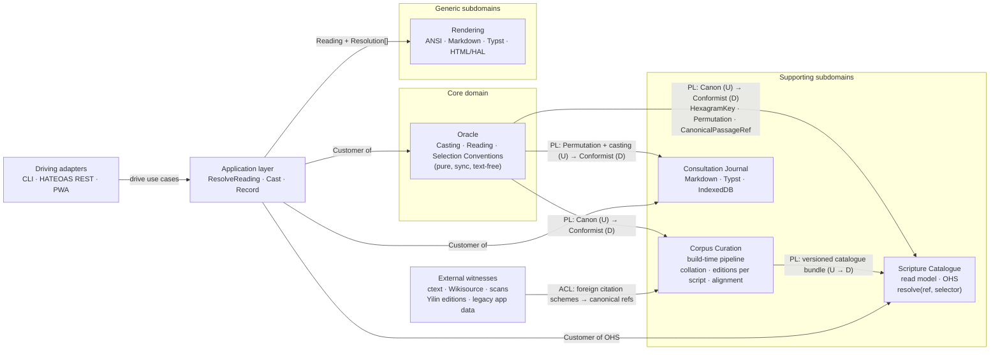
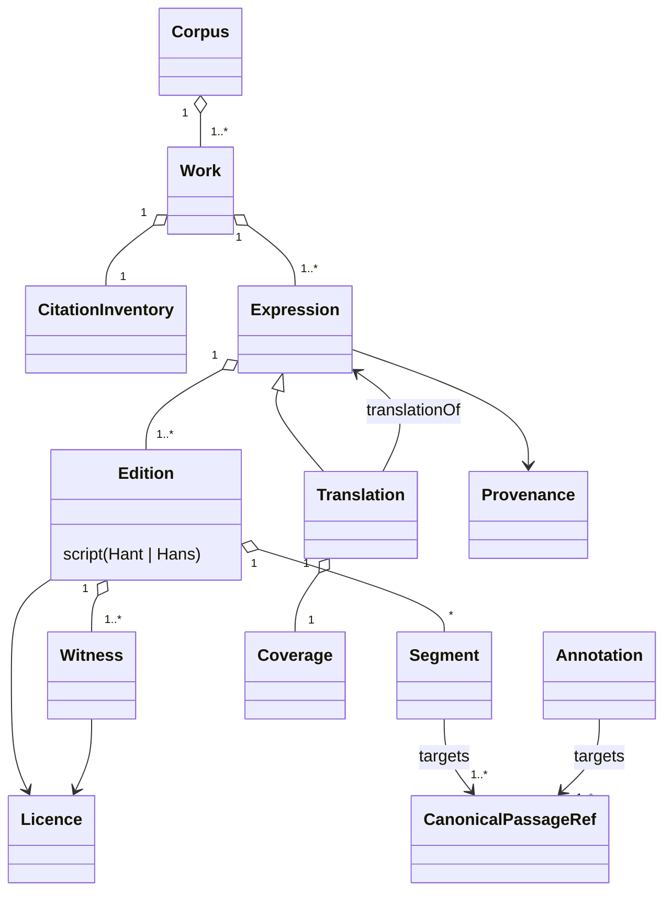

# Scripture in the core domain: include or exclude?

Date: 2026-11-04 · Status: analysis for the owner (not a decision) · Scope: domain reasoning only, for the planned DDD + Hexagonal rebuild. It deliberately ignores the current implementation, apart from the earlier surveys used as background.

---

## 0. Recommendation in one paragraph

**Split it.** The core domain should **include the selection rule and the passage identity**, and **exclude the scriptural text, its translations and its editions in either script**.

The Oracle core computes, purely and statelessly:
1. the casting;
2. the `Reading` (standing, emerging, moving positions);
3. under a named **Selection Convention** (Zhu Xi 考變占, "all moving lines", Jiao Shi Yilin), the **ranked list of `CanonicalPassageRef`s** that apply.

It never touches a character of text. The text lives in a supporting **Scripture Catalogue** context. The Catalogue is a read-only Open Host Service that resolves `(ref, expression selector)` to a passage with provenance and licence. It is fed at build time by a **Corpus Curation** pipeline that sits behind an Anti-Corruption Layer facing the external witnesses (ctext, Wikisource, scans, Yilin editions).

The **Canon**, meaning the citation scheme of the 經 (64 × {judgment, 6 lines} + 2 用 statements = 450 refs) and the 4,096 Yilin pair refs, is the Published Language between the two contexts. The Oracle publishes it, and the Catalogue conforms to it.

---

## 1. What is actually being decided

"Scripture" bundles three different things that change for different reasons and are owned by different expertise:

| Layer | Example | Nature | Expertise needed | Rate of change |
|---|---|---|---|---|
| **Structure / address space** | "乾 has a 用九 statement; 屯 does not"; "line 3 of H122212" | Fixed fact of the Work's shape | Yijing structure | Never |
| **Selection rule** | "Two moving lines → read both in the standing hexagram, the upper is primary" | Hermeneutic procedure, attributable to a named tradition | Divinatory tradition (Zhu Xi, 左傳 precedents, Jiao Yanshou) | Rare; versioned when it does |
| **Content** | 「用九：見群龍无首，吉。」, Legge's "dragons without heads", a published 简体 edition's text | Text as realised by an edition or a translator | Philology, translation, licensing | Edition swaps, new translations, licence changes |

"Include scriptures in the core?" only makes sense once you say which layer you mean. The recommendation puts the first two in the core and the third outside it.

---

## 2. Analysis by lens

### 2.1 Core vs supporting vs generic (Evans, Vernon)

Where does the *differentiating* complexity live, meaning the thing a practitioner would choose this app for over a coin app or a PDF?

- **Casting math (四營, 三變成爻).** This is the product identity: 易**筮**占, "Yarrow" (ADR-0014). The algorithm is small, but fidelity is subtle: the never-empty-right-heap clamp, manual transcription validation, the randomness model and its effect on line frequencies. Getting these right is the credential. **Core.**
- **The selection rule.** This is small in code but hermeneutically dense, and it is where competitors are usually wrong or silent. Most apps "show all moving lines" without saying so. Zhu Xi's seven cases are not a function of the moving *count* alone:
  - Cases 2 and 4 rank by position (upper or lower).
  - Case 4 and case 5 read the *static* lines of the *emerging* hexagram.
  - Case 6 depends on whether the figure is 乾 or 坤.
  - In 易學啟蒙, case 3 ranks 貞/悔 by *which* of the 20 three-line masks moved (「前十卦主貞，後十卦主悔」; verify against the edition and its 卦變圖 ordering).

  This is exactly the kind of rule that rewards a deep model and exhaustive tests over the finite domain. **Core.**
- **The corpus itself.** It is large, but its complexity is *curatorial*, not divinatory: choosing an edition, collating variants, aligning translations and editions in each script, and tracking rights. That work is essential, it cannot be bought off the shelf with passage alignment, licence metadata and offline packaging, and it is not where the oracle's correctness lives. **Supporting** (custom-built).

So the core/supporting line falls *between* the rule and the content, not around "scripture" as a whole.

### 2.2 Rule vs content: does the oracle need the text?

Test every input that each selection convention reads:

| Convention case | Inputs read |
|---|---|
| Zhu Xi 0–6 | moving count, moving positions, static positions, standing key ∈ {乾, 坤}, emerging key, (case 3) moving mask |
| All-moving | moving positions, standing and emerging keys |
| Jiao Shi Yilin | (standing key, emerging key) |

**No case reads a character of text.** The one thing that *looks* textual, "乾 and 坤 have a seventh statement", is a fact about the Work's *structure*, not its content. It belongs in the Canon's address space as an invariant ("`use` exists iff key ∈ {H111111, H222222}"). The oracle therefore needs a **stable reference** to a passage, never the passage. This is the decisive argument.

### 2.3 Rate of change and ownership

- The 經 and Yilin *Works* are frozen. Their *Expressions and Editions* are not:
  - The owner may swap the base edition, for example from a 十三經注疏 text to Zhu Xi's 周易本義 古本 arrangement, which suits a Zhu Xi convention.
  - The owner may fix punctuation, add the Mawangdui witness, or correct an OCR slip.
- Translations come and go for **licence** reasons. Legge (1882) is public domain. Wilhelm–Baynes (Princeton 1950; Baynes d. 1977) is presumed in copyright, roughly into the mid-2040s, and needs verification. It may be allowed in a local CLI but forbidden in the public REST API or PWA.
- A 简体 Edition arrives, or is withdrawn, on its own schedule and under its own licence.
- If text sat in the core, each of these would be a change to the core. Every licence decision would become a domain-model change, and every property test over 4,096 permutations would churn with an edition swap. Keeping text out means the core changes only when the *divinatory* theory changes.

To be honest about it: the Chinese 經 is near-frozen, so rate of change *alone* would not exclude it. The decisive factors are **multiplicity** (one ref maps to many expressions and editions), **licensing** (channel-dependent), **expertise** (philology is not divination) and **size and loading** (§2.5).

### 2.4 How the 4,096 permutations relate to the two corpora

- **Permutation ↔ (standing, emerging) is a bijection.** Each line is a pair of polarities: 7 = (yang, yang), 9 = (yang, yin), 8 = (yin, yin), 6 = (yin, yang).
- **Yijing is *selected*:** 4,096 permutations map, through a convention, onto subsets of 450 經 refs. This is many-to-few and non-trivial, and the result can include passages from the *emerging* hexagram.
- **Yilin is *keyed*:** 4,096 permutations map onto 4,096 verses as a bijection, so the "rule" is the identity on the pair. This includes the 64 self-pairs X→X, which is the zero-moving-line case and requires `emerging = standing` (§9.1).

So Yilin is best modelled as just another **Selection Convention** (`jiaoshi-yilin`) whose output is always exactly one ref. The core then has one uniform shape, `Reading → RankedRef[]`, and the Yilin corpus lives in the Catalogue like any other Work.

### 2.5 Purity, statelessness (REST) and bundle size / offline (PWA)

- **REST.** `GET /readings/{permutation}` and `.../selections/{convention}` are pure functions over a finite domain. They can be precomputed (4,096 × conventions) and served `immutable` from a CDN. Passage resources are immutable per catalogue version, keyed by `ETag`. Nothing is stateful anywhere. Purity holds *either way*, but a ref-only core is purer: its output does not depend on a catalogue version.
- **PWA.**
  - A text-free core is a few kB and works fully offline with zero data.
  - Text loads lazily, chunked by (edition, hexagram) for the Yijing and (edition, standing-hexagram chapter) for the Yilin. A Yilin chapter is about 64 verses × ~16 characters, so a few kB.
  - The default Chinese Yijing is small enough to precache. Translations and the Yilin load on demand or by "download for offline" into IndexedDB.
  - If text sat in the core, the core module would drag every corpus into the critical bundle, or the core would grow lazy-loading concerns.
  - This IndexedDB *catalogue cache* is a different port from the IndexedDB *consultation repository*. They have the same technology but different contexts.
- **Async boundary.** Because of lazy loading, the Catalogue read port is async. The core stays synchronous and total. That asymmetry is itself a sign that they are different contexts.

### 2.6 Published Language, Open Host Service and Anti-Corruption Layer

- **Published Language: the Canon.** It contains `HexagramKey`, `LinePosition`, `Permutation` and `CanonicalPassageRef`. It is published by the Oracle and conformed to by the Catalogue, persistence, renderers, and the REST API's external clients.
- **Open Host Service: the Catalogue**, behind one read port that every adapter uses (CLI file adapter, REST in-memory adapter, PWA IndexedDB/HTTP adapter). Its *data artefact* is also a Published Language: a versioned, schema-described bundle.
- **ACL in the right place.** The messy translation layer is **between external witnesses and Curation**, not between the core and the Catalogue. ctext's paragraph numbering, Legge's appendix layout and Wilhelm–Baynes's Book I/III split with a)/b) merged line entries are all mapped to canonical refs at ingest. The current app's records (where `Exegesis.Judgment` means 彖傳 and Wilhelm–Baynes line "exegesis" merges text and commentary) are one more external source behind that ACL.

### 2.7 The tradition axis: domain or configuration?

**Conventions are domain; choosing one is a parameter.**

- Each convention has:
  - a name and a citation (Zhu Xi, 《易學啟蒙·考變占》);
  - a deterministic algorithm;
  - acceptance cases taken from its source text.

  That is domain knowledge, so it lives in the core as a **closed tagged union** of versioned conventions (`zhuxi-kaobian@1`). It is not a runtime plugin registry, because there should be no speculative extension point (AGENTS.md rule 6). Adding a fourth convention is a reviewed domain change.
- *Which* convention or conventions run is a user preference, carried as a request parameter in REST and a setting in the CLI and PWA. It is not deploy-time configuration and it is not data-driven rule tables.
- **The 筮/占 boundary (ADR-0014).** Zhu Xi called this step 考變**占**, which makes it a boundary case. It stays on the 筮 side as long as the app (a) names the convention, (b) emits *refs and ranks*, never glosses, and (c) offers the unranked `all-moving` convention. Ranking (貞/悔, primary/secondary) is still citation of a tradition, not interpretation. The owner should confirm this reading of the boundary (§13).

---

## 3. Demarcation: bounded contexts

| Context | Classification | Owns | Does not own |
|---|---|---|---|
| **Oracle** (modules: *Casting*, *Reading & Selection*) | **Core** | 大衍 procedure, divisions, line determination, `Permutation`, `Reading`, Selection Conventions, **the Canon** (Published Language) | Any text, names in any language, editions, licences |
| **Scripture Catalogue** (runtime read model) | **Supporting** | Corpora, Works, Expressions, Editions (each with one script), Witnesses, Segments, Alignment, Annotations (傳 and translator-commentary attachments), Nomenclature (hexagram names per Edition), Provenance, Licence gate | Selection, casting |
| **Corpus Curation** (build-time pipeline) | **Supporting** | Ingest from witnesses (ACL), diplomatic transcription per Edition (no conversion), collation decisions, alignment authoring, coverage checks, publishing the catalogue bundle | Runtime serving |
| **Consultation Journal** | Supporting | Consultation aggregate: query, casting, timestamp, optionally the convention id and catalogue version used; repositories for Markdown, Typst and IndexedDB | Text (rendered bodies are decorative, never canonical) |
| **Rendering** | Generic | ANSI, Markdown, Typst and HTML/HAL serialisation of `Reading` + `Resolution[]`, including the **attribution block** licences require | Choosing passages |
| Language-tag negotiation (CLDR) | Generic | Library used by the REST adapter | Script conversion (deliberately absent, §6) |

The **application layer** (hexagon) composes these through use cases such as `ResolveReading(permutation, conventions, selector)`:

```
reading   = Oracle.readingOf(permutation)
selection = Oracle.select(reading, convention)       // pure, sync
passages  = await Catalogue.resolveMany(selection.refs, selector, commentaryProfile)
```

The core never calls the catalogue. A lint rule (as for `domain → cli` today) should forbid any `oracle → catalogue` import.

### 3.1 Context map



Legend: U = upstream, D = downstream. The Oracle is upstream of everything that mentions a passage. Nothing flows *into* the Oracle except a permutation or a sequence of divisions.

---

## 4. Canonical passage identity: the Canon

### 4.1 Principles

1. **Identity is structural, not textual.** A ref names a slot in the Work's citation scheme. It never names a string, a translation or a script.
2. **Figures are keyed by line pattern, not by sequence number.** `HexagramKey` = `H` + six of {1 = yang, 2 = yin}, bottom line first. King Wen and Fuxi numbers are *lookups*, because King Wen order is itself a fact about 序卦.
3. **Positions are numeric 1..6, bottom-first.** The traditional labels (初九, 六二, … 上六) are *derived* from key polarity and position. They are never stored and never part of a ref, so the ref cannot become inconsistent with the figure.
4. **The core owns only refs it can emit.** That is the 經 and the Yilin. 傳 layers and translator commentary have their own refs, owned by the Catalogue, and attach to 經 refs through **Annotation** edges (§4.3).

### 4.2 Grammar (core-owned refs)

Canonical string form is `{work}:{locus}`, with dot-separated segments. These are URL-safe and map 1:1 to path segments.

| Ref kind | Canonical string | Path form (REST) | Count | Validity invariant |
|---|---|---|---|---|
| Judgment 卦辭 | `jing:H111111.judgment` | `/passages/jing/H111111/judgment` | 64 | every key |
| Line statement 爻辭 | `jing:H122212.line.3` | `/passages/jing/H122212/line/3` | 384 | position ∈ 1..6 |
| Use statement 用九/用六 | `jing:H111111.use` | `/passages/jing/H111111/use` | 2 | key ∈ {H111111, H222222} only |
| Yilin verse 林辭 | `yilin:H111111.H222222` (standing.emerging) | `/passages/yilin/H111111/H222222` | 4,096 | every ordered pair, including X.X |

TypeScript shape (core):

```ts
type HexagramKey = `H${Bit}${Bit}${Bit}${Bit}${Bit}${Bit}`   // Bit = '1' | '2'
type LinePosition = 1 | 2 | 3 | 4 | 5 | 6                     // bottom-first

type CanonicalPassageRef =
  | { work: 'jing';  hexagram: HexagramKey; part: 'judgment' }
  | { work: 'jing';  hexagram: HexagramKey; part: 'line'; position: LinePosition }
  | { work: 'jing';  hexagram: 'H111111' | 'H222222'; part: 'use' }   // invariant by type
  | { work: 'yilin'; standing: HexagramKey; emerging: HexagramKey }

formatRef(ref): string;  parseRef(s): Result<CanonicalPassageRef, RefError>
```

These ids can be aliased to CTS URNs (`urn:cts:…:zhouyi.jing:H111111.line.3`) for interchange. Adopting CTS wholesale is optional (§13).

### 4.3 How the 傳 (Ten Wings) and other commentary attach

The 傳 are separate **Works** with their own citation schemes. Attachment to 經 refs is a **relation**, not a nesting, because some attachments are 1:1 and others are many-to-many:

| Work | Catalogue ref | Attaches to (`annotates`) | Cardinality |
|---|---|---|---|
| 彖傳 Tuan | `tuan:H111111` | `jing:H111111.judgment` | 1:1 |
| 大象 Great Image | `daxiang:H111111` | the hexagram as a whole (`jing:H111111.judgment` as anchor) | 1:1 |
| 小象 Small Image | `xiaoxiang:H111111.line.3`, `xiaoxiang:H111111.use` | `jing:H111111.line.3` / `.use` | 1:1 |
| 文言 Wenyan | `wenyan:H111111.s{n}` (sections) | several 乾/坤 refs; sections revisit the same lines | n:m |
| 繫辭 Xici | `xici:shang.s{n}`, `xici:xia.s{n}` | occasional specific lines (e.g. 中孚 九二), mostly none | n:m, often 0 |
| 說卦 Shuogua | `shuogua:s{n}` | **trigrams**, not hexagrams (a `TrigramKey` anchor) | n:m |
| 序卦 Xugua | `xugua:H{key}` (segmented per figure) | the hexagram, plus a `follows` link to its King Wen predecessor | 1:1 + sequence |
| 雜卦 Zagua | `zagua:s{n}` | one or two hexagrams (pairings) | 1:2 |
| Translator commentary (e.g. Wilhelm's own notes) | `wilhelm-commentary:H111111.line.3` | `jing:H111111.line.3` | 1:1 |

`Annotation { source: CatalogueRef; targets: CanonicalPassageRef[]; relation: 'comments-on' | 'images' | 'sequence' | 'pairs-with' }`

The **Commentary Profile** belongs to the reader or the request, for example `[tuan, daxiang, xiaoxiang]` or `[]`. The Catalogue *expands* the Oracle's selected 經 refs into companion commentary along these edges. That keeps "show 大象 with the judgment" out of the Oracle: it is a display preference over the annotation graph, not a divinatory rule. Zhu Xi's rules select only 經 passages.

Watch the terminology trap: in Zhu Xi's rules, 「彖辭」 means the **卦辭** (judgment), not the **彖傳**. The glossary must keep *Judgment (卦辭)* and *Tuan Commentary (彖傳)* apart. Avoid the bare word "Judgment" for 彖傳, which Wilhelm–Baynes and the current code both invite.

---

## 5. Corpus, Work, Expression, Edition, Witness, Translation

This is FRBR-inspired (Work / Expression / Manifestation / Item), adapted to a citation-driven catalogue.

| Concept | Definition | Examples | Carries |
|---|---|---|---|
| **Corpus** | A catalogue grouping of Works that share one citation family | `yijing` (經 + 十翼), `yilin` | Works, default expression per language |
| **Work** | The abstract text, independent of wording | 周易經; 彖傳; 大象; 焦氏易林; *Wilhelm's commentary* (a Work in its own right) | **Citation Inventory**: the complete set of valid loci |
| **Expression** | One realisation of a Work in a language and text tradition | 通行本 (received text, zh); 帛書本 Mawangdui (zh, different names: 鍵 for 乾, 川 for 坤); Legge (en); Wilhelm (de); Baynes (en, *from* Wilhelm de) | language, `expressionOf`, `translationOf?`, `derivedFrom?` (relay translation), translator or editor |
| **Translation** | An Expression whose `translationOf` points at another Expression; it adds an **Alignment** | Legge ← 通行本; Baynes ← Wilhelm ← 通行本 | alignment, coverage |
| **Edition** (Manifestation) | A published embodiment: punctuation, collation choices, paratext | 阮元《十三經注疏》1816; 朱熹《周易本義》; SBE vol. 16 (1882; 2nd ed. 1899); Princeton 1950/1967 | publisher, year, collation notes, **licence of the edition layer** (punctuation and collation can carry thin rights) |
| **Witness** (Item / source) | The concrete source the app's data was transcribed from | a ctext.org page set; a Wikisource revision; a scan | URL or identifier, retrieval date, checksum, licence of the digitisation |
| **Segment** | A stored unit of text in one Edition, transcribed diplomatically from its Witness. There is no derived or converted text (§6) | — | `segmentId`, `targets: Ref[]`, `kind`, `text`, order |

Script (`zh-Hant` / `zh-Hans`) is an **attribute of the Edition**, not a separate layer.



**Pragmatic collapse.** Until a second Edition of the same Expression actually exists, the implementation may store Work, Expression and Edition as **one `Expression` record** with flattened provenance fields. The *concepts* stay in the glossary so the split is cheap later. This guards against the over-engineering risk raised in §12.

---

## 6. Traditional vs Simplified script

### 6.1 Decision (owner, 2026-11-04): no conversion, ever. Each script is its own sourced Edition

*This revises an earlier draft, which made 简体 a Rendition derived by OpenCC with "Protected Terms".* The owner rejected that design. Protected terms are not a fix. They are a list of known edge cases standing in for a judgement that the converter cannot make. Character conversion T↔S is not a function on *meaning*:
- 後/后 → 后, and 乾/幹/干 → 干, are many-to-one;
- whether 后 is "sovereign" (泰 大象「后以財成天地之道」) or "after" takes reading, not lookup;
- every converted page would carry an unknown number of silent errors that no test could enumerate.

The model therefore has **no derived text of any kind**:
- **简体 text comes only from a published 简体 Edition** (e.g. a named 中华书局 or 上海古籍 简体 edition), transcribed from its own Witness, with its own provenance and licence. Whoever edited that book made the 后/乾/遁 judgements and is accountable for them; the app inherits them by citation.
- **Traditional text likewise reproduces its edition's orthography diplomatically.** That includes 无, 爲 and 衆 as printed. There is no normalisation to a regional standard (zh-Hant-TW or -HK), because normalisation is also conversion.
- **Different scripts are different Editions.** Two Editions of the same Expression may differ in script, punctuation and collation. Each aligns *independently* to the Canon and declares its own Coverage. Nothing is checked in as "the same text in another script", so there are no copies that can drift. Each Edition stands on its own Witness.
- **If no suitable 简体 Edition is available (or licensable), the app does not offer 简体.** A request for zh-Hans gets an honest `absent` (reason `not-in-edition` / `not-yet-curated`) or a negotiated fallback to zh-Hant that is declared in `Content-Language`. It never gets a machine-made page.
- **Clarification (owner, 2026-11-05): the rule constrains what the app does.** The app never mechanically maps text from Traditional to Simplified (or back). A third-party text whose own origin cannot be traced is not a conversion by us. It may be kept, recorded with its Witness and with its Edition marked **unidentified**, and labelled as such wherever it is shown. The current Simplified and Traditional texts (Witness: ctext.org) are kept on that basis. Whether they may go out through public channels is a separate licence question: ctext's terms forbid scraping, and redistribution is unverified.

Consequence: the concepts *Rendition*, *Conversion Profile* and *Protected Term* are removed. A Segment belongs directly to an Edition. Script is an attribute of the Edition (`script: Hant | Hans`, with the BCP 47 tag `zh-Hant` / `zh-Hans`).

### 6.2 Cases that motivated the decision

Each of these is a judgement that a published edition already made and a converter cannot make:

| Case | Why conversion fails | Handling under "no conversion" |
|---|---|---|
| **乾 the hexagram name** and **乾乾** (乾 九三 「君子終日乾乾」) | Converters map 乾→干 | The 简体 edition prints what its editor chose (typically 乾). The app reproduces it |
| 后 (sovereign) vs 後 (after) | Merged in 简体; S→T needs reading | Each edition's text is taken as printed; no direction of derivation exists |
| 无 vs 無 | The received text writes 「无咎」 even in Traditional; normalisers "fix" it | Diplomatic reproduction keeps the edition's 无 |
| 遯 / 遁 (hexagram 33), 爲/為, 衆/眾, 晉/晋 | Variant characters (異體字), not script | Whatever the edition prints |
| 繫辭 / 系辞 | Also a Work title | Nomenclature is taken from the edition, per Edition |

### 6.3 Where each kind of decision lives

| Decision | Lives in | Mechanism |
|---|---|---|
| **Textual variants** (異文: different *words* between witnesses, e.g. 帛書 vs 通行本, Yilin edition corruptions) | **Edition** (Curation context) | The edition's text is the chosen reading. An optional apparatus is stored as Annotations of kind `variant` |
| **Variant characters** (異體字 orthography) | **Edition** | Reproduced diplomatically from the Witness; never normalised |
| **Script** (Hant / Hans) | **Edition** attribute | Chosen by choosing an Edition; never computed |
| **Hexagram and Work names** | **Nomenclature** table in the Catalogue, **taken per Edition, never converted** (64 names per shipped Edition, plus English names per translation, e.g. Legge "Khien", Wilhelm–Baynes "The Creative") | Small and eager-loaded, so every adapter can show names without loading scripture |

Names are *not* in the core. The Mawangdui expression names 乾 as 鍵 and 坤 as 川, so even the Chinese name depends on the Expression. The core identifies a figure only by `HexagramKey`, plus the structural facts derivable from it: trigrams, King Wen and Fuxi order, and the U+4DC0 symbol.

---

## 7. Translation alignment

- **Granularity: the passage**, aligned to `CanonicalPassageRef` (and to Catalogue refs for 傳). Sentence-level alignment is out of scope.
- **Segment kinds:**
  - `translation`: renders the source passage.
  - `translator-commentary`: the translator's own Work, attached as an Annotation. Wilhelm's commentary must never be presented as 小象.
  - `paratext`: headings or notes.
- **Coverage is declared, never inferred.** For each Expression, every locus in its Work's Citation Inventory has exactly one coverage entry:

| Coverage | Meaning | `resolve` result |
|---|---|---|
| `covered(segmentId)` | 1:1 | the segment |
| `split(segmentIds[])` | one ref spread over several segments | ordered segments, concatenated by the renderer |
| `merged(segmentId, alsoCovers: Ref[])` | one segment covers several refs (e.g. a translator fusing 爻辭 with 小象, or 卦辭 with 彖) | the segment plus `alsoCovers`; `resolveMany` **dedupes by segmentId** so it is not printed twice |
| `omitted(reason)` | the translator left it out or folded it elsewhere | `absent{reason: 'omitted-by-translator'}`. **No silent fallback** to another translation |
| `not-yet-curated` | a gap in the data | `absent{reason: 'not-yet-curated'}`. Releases should fail the coverage check unless the gap is explicitly waived |

- **Fallback is a selector policy, made visible.** If the reader asked for Legge and Legge omits a passage, the adapter may show the Chinese with an explicit "not in Legge" marker. It must never splice in Wilhelm–Baynes unannounced. REST reports the actual `Content-Language` and links the alternates.
- **Provenance and licence are first-class attributes**, on Expression, Edition and Witness:

```ts
type Provenance = {
  translatorOrEditor?: string; publisher?: string; year?: number
  derivedFrom?: ExpressionId              // relay translation: Baynes ← Wilhelm
  witness: { uri: string; retrievedAt: string; checksum: string }
}
type Licence = {
  spdx?: string                           // 'CC-BY-SA-4.0', 'PDM-1.0', …
  status: 'public-domain' | 'licensed' | 'proprietary' | 'unknown'
  rightsHolder?: string
  permits: { display: boolean; redistribute: boolean; offlineCache: boolean }
  attribution?: string                    // must be rendered wherever text is shown
}
```

The **Licence Gate** is a Catalogue policy. `resolve` takes the *channel purpose* (`local-display` | `public-redistribution` | `offline-cache`) and returns `absent{reason: 'licence-restricted'}` for an expression whose licence does not permit it. For example, Wilhelm–Baynes could be served only from a user-supplied file in the local CLI, never from the public REST API or the PWA precache. Renderers must print the attribution, including inside saved Markdown and Typst files.

---

## 8. Ports

### 8.1 Core (Oracle) published functions: pure, synchronous, total

```ts
type Permutation = string & { readonly __brand: 'Permutation' }  // /^[6789]{6}$/, bottom-first, e.g. '978876'

type Reading = {
  permutation: Permutation
  standing: HexagramKey
  emerging: HexagramKey              // = standing when nothing moves (§9.1)
  moving: readonly LinePosition[]    // ascending
}

type ConventionId = 'zhuxi-kaobian@1' | 'all-moving@1' | 'jiaoshi-yilin@1'

type RankedRef = { ref: CanonicalPassageRef; rank: 'primary' | 'secondary' | 'context' }

type Selection = {
  convention: ConventionId
  rule: string                       // e.g. 'zhuxi.case-2' — stable, citable label of the case applied
  refs: readonly RankedRef[]         // non-empty, deterministic order
}

readingOf(p: Permutation): Reading
select(r: Reading, c: ConventionId): Selection
enumeratePermutations(): Iterable<Permutation>   // 4,096, for property tests and precompute
```

The **Zhu Xi convention** (`zhuxi-kaobian@1`), as refs only:

| Moving | Primary | Secondary | Rule label |
|---|---|---|---|
| 0 | `jing:S.judgment` | — | case-0 |
| 1 | `jing:S.line.m` | — | case-1 |
| 2 | `jing:S.line.(upper m)` | `jing:S.line.(lower m)` | case-2 |
| 3 | `jing:S.judgment` or `jing:E.judgment` (貞 or 悔 by mask, per 「前十卦主貞，後十卦主悔」) | the other judgment | case-3 |
| 4 | `jing:E.line.(lower static)` | `jing:E.line.(upper static)` | case-4 |
| 5 | `jing:E.line.(the static one)` | — | case-5 |
| 6 | 乾 → `jing:H111111.use`; 坤 → `jing:H222222.use`; else `jing:E.judgment` | — | case-6 |

S = standing, E = emerging. The table should be locked by a test over all 4,096 permutations, with fixed cases taken from 易學啟蒙.

`all-moving@1` returns both judgments as `context` and every moving line of S as `primary`, unranked among themselves. `jiaoshi-yilin@1` returns `[{ ref: yilin:S.E, rank: 'primary' }]`.

### 8.2 Catalogue read port: driven, async, OHS

```ts
type ExpressionSelector =
  | { edition: EditionId }                                                          // explicit (fixes expression and script)
  | { languages: readonly LanguagePreference[]; translator?: string }               // negotiated
type Purpose = 'local-display' | 'public-redistribution' | 'offline-cache'

type Resolution =
  | { kind: 'found'; ref: CanonicalPassageRef | CatalogueRef; expression: ExpressionId
      edition: EditionId; script?: 'Hant' | 'Hans'; segments: readonly Segment[]; alsoCovers: readonly Ref[]
      provenance: ProvenanceSummary; attribution?: string }
  | { kind: 'absent'; ref: Ref; expression: ExpressionId
      reason: 'omitted-by-translator' | 'not-in-edition' | 'not-yet-curated' | 'licence-restricted'
      alternates: readonly ExpressionId[] }

interface ScriptureCatalogue {
  expressions(filter?: { work?: WorkId; language?: string; purpose?: Purpose }): Promise<readonly ExpressionSummary[]>
  resolve(ref: Ref, sel: ExpressionSelector, purpose: Purpose): Promise<Resolution>
  resolveMany(refs: readonly Ref[], sel: ExpressionSelector, purpose: Purpose,
              commentary?: CommentaryProfile): Promise<readonly ResolutionGroup[]>  // expands annotations, dedupes merged segments
  nomenclature(key: HexagramKey, sel: ExpressionSelector): Promise<HexagramName>
  provenance(expression: ExpressionId): Promise<Provenance & { licence: Licence }>
}
```

### 8.3 REST: HATEOAS, stateless, no persistence

- `GET /readings/978876` returns a `Reading`. Links:
  - `self`
  - `standing` → `/hexagrams/H…`
  - `emerging` → `/hexagrams/H…`
  - `selection` (templated `{?convention}`)
  - `yilin` → `/passages/yilin/H…/H…`
- `GET /readings/978876/selections/zhuxi-kaobian@1` returns a `Selection`. Each ref is a link to `/passages/jing/{key}/line/{n}` with `rank`. `alternate` links point to the other conventions.
- `GET /passages/jing/H111111/use` is negotiated:
  - **Script** comes from `Accept-Language: zh-Hant, zh-Hans;q=0.8, en;q=0.5`. Region-only tags are mapped to script with CLDR likely subtags: zh-TW, zh-HK and zh-MO → Hant; zh-CN and zh-SG → Hans.
  - The response carries `Content-Language` and `Vary: Accept-Language`, plus `Link: <…/editions/{id}>; rel="alternate"; hreflang="…"` for every available edition. A zh-Hans request with no curated 简体 Edition falls back to zh-Hant **declared** in `Content-Language`; it is never converted.
  - **Accept-Language cannot choose between two English translators**, so `/passages/{ref}/editions/{editionId}` is the explicit, cacheable form. Negotiation only picks a default and returns a `Content-Location` pointing at the explicit URL.
- `GET /expressions` and `GET /expressions/{id}` return provenance, licence and coverage summary. The public API filters with `purpose = public-redistribution`.
- Caching:
  - Readings and selections: `Cache-Control: public, max-age=31536000, immutable`, because they are pure in (permutation, convention@version).
  - Passages: `ETag` = catalogue bundle version.

### 8.4 PWA

- Core plus the default zh-Hant Yijing Edition is precached.
- Other editions (including any 简体 Edition), translations and Yilin chapters load lazily into an IndexedDB **catalogue cache** adapter of the *same* `ScriptureCatalogue` port, gated by `purpose: 'offline-cache'`.
- Parity with REST is by construction: same core, same port, different adapter.

---

## 9. Ubiquitous language (glossary additions)

| Term | Chinese | Definition | Avoid |
|---|---|---|---|
| **Permutation** | 六爻之數 | The six line values (6/7/8/9), bottom-first, as a canonical string such as `978876`. One of 4,096 | "hexagram" for the 6/7/8/9 tuple |
| **Reading** | — | The Oracle's computed result for a Permutation: standing, emerging, moving positions. ⚠ CONTEXT.md currently bans "reading" as a synonym for Consultation; the owner must choose (§13) | — |
| **Standing Hexagram** | 本卦 | The figure formed by the line polarities as cast | primary, original |
| **Emerging Hexagram** | 之卦 | The figure after every moving line flips; equals Standing when nothing moves | changed, relating, future |
| **Moving / Static Line** | 變爻 / 不變爻 | Line value 6 or 9 / 7 or 8 | changing, old/young (as type names) |
| **Line Position** | 爻位 | 1..6, bottom-first; labels 初…上 and 九/六 are derived | — |
| **Hexagram Key** | — | Structural identity of a figure (`H` + 6 bits, bottom-first) | King Wen number as identity |
| **Canon** | 經之目 | The citation scheme of the 經 plus the Yilin pair space: the Published Language | — |
| **Canonical Passage Ref** | — | Identity of a passage slot in the Canon | text id, passage (for the ref itself) |
| **Judgment** | 卦辭 | The statement attached to a whole hexagram in the 經 | "彖" unqualified |
| **Line Statement** | 爻辭 | The statement attached to one line | line text (ambiguous with commentary) |
| **Use Statement** | 用九 / 用六 | The seventh statement, existing only for 乾 and 坤 | "7th line" |
| **Tuan Commentary** | 彖傳 | The Ten Wings commentary on the Judgment | "Judgment" (the Wilhelm–Baynes trap) |
| **Great Image / Small Image** | 大象 / 小象 | 象傳 on the hexagram / on each line (and 用) | exegesis (too vague) |
| **Ten Wings** | 十翼 / 易傳 | The commentary Works: 彖上下, 象上下, 文言, 繫辭上下, 說卦, 序卦, 雜卦 | — |
| **Yilin Verse** | 林辭 | Jiao Yanshou's verse for one ordered (standing, emerging) pair | — |
| **Selection Convention** | 占法 / 考變 | A named, versioned, cited rule mapping a Reading to Ranked Refs | method, mode, tradition (as type names) |
| **Ranked Ref** | 貞 / 悔 | A ref with rank primary, secondary or context | — |
| **Corpus, Work, Expression, Translation, Edition, Witness** | — | As in §5; script is an Edition attribute | "variant" (overloaded), "version" |
| **Diplomatic transcription** | — | Reproducing a Witness's characters exactly as printed; the only way text enters the Catalogue | "conversion", "normalisation", "rendition" (rejected concepts, §6) |
| **Segment, Alignment, Coverage** | — | As in §7 | — |
| **Annotation, Commentary Profile** | — | A commentary-to-passage edge; the reader's choice of which commentary Works to expand | — |
| **Provenance, Licence, Licence Gate, Purpose** | — | As in §7 | — |
| **Nomenclature** | 卦名 | Per-Edition names of hexagrams and Works, taken from the Edition, never converted | — |

---

## 10. Invariants

**Canon (core)**
1. There are exactly 64 `HexagramKey`s and exactly 450 `jing` refs: 64 judgments, 384 lines and 2 use statements.
2. `jing:K.use` is valid ⇔ K ∈ {H111111, H222222}. This is enforced by the type and by `parseRef`.
3. There are exactly 4,096 `yilin` refs, one per ordered pair including X.X, in bijection with Permutations.
4. Permutation ↔ (standing, emerging, moving) is a bijection, and `emerging = standing ⇔ moving = []`.
5. Line labels (初九 …) are derived and never stored.

**Selection (core)**

6. `select` is **total and deterministic** over all 4,096 Permutations for every `ConventionId`. Every emitted ref satisfies 1–3, and `refs` is non-empty.
7. Every Zhu Xi result names exactly one `rule` case, and that case is a function of the moving count.
8. A result depends only on `(permutation, conventionId@version)`. It never depends on the catalogue version.
9. The Oracle has no import path to the Catalogue or to any text. This is lint-enforced.

**Catalogue**

10. Every Expression declares Coverage for **every** locus of its Work's Citation Inventory. Undeclared gaps fail the build.
11. Every Segment targets at least one valid ref. A ref's segments are ordered and do not overlap.
12. Every Segment is a diplomatic transcription of its Edition's Witness. No text in the Catalogue is produced by script conversion or orthographic normalisation, and the curation pipeline has no conversion library to call.
13. Every Edition declares exactly one script. A script is offered only if at least one licensed Edition in that script exists.
14. Nomenclature exists for all 64 keys in every shipped Edition, and is taken from that Edition rather than converted.
15. No text is served without provenance. No text is served on a channel its licence does not permit. Attribution travels with every `found` Resolution.
16. No Edition's text is the source of another Edition's text. Editions in different scripts are independent transcriptions.

**Journal**

17. A Consultation persists the Permutation (or the casting it replays to), and never the scriptural text as canonical data. Rendered bodies are decorative.

---

## 11. Pragmatic staging (so the model does not become ceremony)

1. Ship the **Canon**, `readingOf`, `select` (Zhu Xi + all-moving) and property tests over 4,096. There is no text yet; resolve to an in-memory catalogue of *one* Expression (the base zh-Hant Edition, diplomatic).
2. Add Legge as a Translation with Coverage. Add zh-Hans only when a published 简体 Edition with acceptable provenance and licence is chosen and transcribed.
3. Add the Yilin corpus (a lazy chunk) and the `jiaoshi-yilin` convention.
4. Add the Licence Gate before the first public REST or PWA deploy. Wilhelm–Baynes enters only if the licence allows it, or as a user-supplied local file.

Keep Work, Expression and Edition collapsed (§5) until a second edition exists.

---

## 12. The strongest argument for the opposite position (include the text in the core)

> "The product is **易**筮占. The *text* is what the user came for; a reading without text is a meaningless list of ids. The corpus is immutable, public domain (for Chinese and Legge), and about a megabyte, so it fits in memory. A pure `consult(lines) → { standing, emerging, passages: string[] }` is simpler, just as pure and just as stateless. The split adds refs, an async port, alignment, coverage, editions and licence gates. For a one-person app with four hard-coded variants that is exactly the speculative generality AGENTS.md rule 6 forbids. And the 用九/用六 rule shows that the corpus shape *does* leak into selection anyway."

**Why I reject it.**

1. **The selection rule provably reads no text** (§2.2). The 用九 "leak" is structure, and it lives in the Canon without any text.
2. **Purity is not the differentiator.** Both designs are pure. But a core that embeds text has an output that depends on an edition, its script and a licence decision. With text in the core, a licence change or a swapped 简体 edition becomes a core change and churns every oracle test.
3. **Multiplicity.** One ref maps to N expressions × M editions. With text inside, the core must take language, script, translator and licence purpose as parameters, which pulls i18n and rights into the domain model.
4. **PWA loading and REST cacheability** both want text-free compute plus separately versioned, lazily loaded text (§2.5).
5. **The 筮/占 boundary** (ADR-0014) is cleaner when the core ends at *pointing to* the passage (受命) and the text is what is received.
6. **The cost is controllable.** It amounts to a ref type and one port, with the FRBR concepts collapsed until needed (§11). That is not speculative generality, because Simplified, a second translation, Yilin, the licence split and three adapters are *already* in the requirements.

**Conditions under which I would flip:**

- **Scope shrinks:** CLI only, one public-domain Chinese edition plus Legge, no 简体 projection, no Yilin, no REST or PWA. Then a single module with inline text is the simpler honest design. I would still key the text internally by ref.
- **A convention needs text-derived facts:** for example "prefer the line whose statement contains 吉", or a convention driven by prognostic formulae (吉/凶/悔/吝/无咎). Even then, I would add *structured prognostic tags* to the Canon rather than text, and that convention would cross into 占, which ADR-0014 rules out unless the owner revisits it.
- **The owner decides the catalogue *is* the product:** for example a scholarly multi-witness Yijing reader where collation is the differentiator. Then the Catalogue becomes a **second core** context. It is still separate from the Oracle.

---

## 13. Open questions the owner must decide

1. **Conventions for v1, and the default:** Zhu Xi only, or also `all-moving` and Yilin? Which is the default, and are several run side by side?
2. **Zhu Xi case 3:** adopt the mask-level 貞/悔 ranking (「前十卦主貞，後十卦主悔」)? This needs the 卦變圖 ordering from a named edition of 易學啟蒙. Or treat both judgments as unranked?
3. **Zero moving lines:** `emerging = standing` (recommended; required for Yilin X.X), or "no emerging"? Presentation can still hide it either way.
4. **Ranking and the 筮/占 boundary:** is emitting primary and secondary ranks still 筮 under ADR-0014?
5. **Ref grammar:** the project grammar above (recommended), or CTS URNs as canonical with the project grammar as alias?
6. **Base Chinese edition and witness:** 十三經注疏 通行本, or Zhu Xi's 周易本義 古本 arrangement, which fits the Zhu Xi convention? Should the Mawangdui text be a second Expression? *Resolved (owner, 2026-11-05 / 2026-11-10):* the base Traditional Edition is the 武英殿十三經注疏本《周易正義》 (1739). The Witness is ctext.org, whose 易經 states it follows that edition's scan in the ctext Library. This is not 阮元's 1816 edition, the usual 通行本.
7. **Yilin edition:** which one? The Yilin has heavy textual problems, including duplicated verses across pairs. Should the edition's self-pair verse (X之X) be confirmed for all 64?
8. **Licence posture per channel:** drop Wilhelm–Baynes, keep it as a user-supplied local file, or seek permission? Verify its copyright status. Who is the licensor of the app's own curation layer (punctuation, alignment), and under what licence?
9. ~~**简体:** derived Rendition or published edition?~~ **Resolved (owner, 2026-11-04): no conversion.** 简体 only from a published 简体 Edition. *Follow-up:* which edition, and is it licensable for public REST/PWA? *2026-11-05:* the existing ctext-sourced 简体 text is kept with its Edition marked unidentified until a published 简体 Edition is chosen. *Closed (owner, 2026-11-10):* the Simplified text is ctext.org's Simplified version of the same 易經 page. ctext names no separate 简体 source edition, so its Edition stays labelled **unidentified**. No published 简体 Edition is planned.
10. ~~**Orthography of the default Traditional:** diplomatic or regional standard?~~ **Resolved by the same decision:** diplomatic edition forms (爲, 无); normalisation is conversion.
11. **Default Commentary Profile:** 彖, 大象 and 小象 alongside the 經? Should translator commentary (Wilhelm's) be shown, and how is it labelled?
12. **Fallback policy** when the chosen translation omits a passage: show Chinese with a marker (recommended), show nothing, or allow another translation explicitly?
13. **Consultation provenance:** should a saved Consultation record the `conventionId@version` and catalogue bundle version it was displayed with? This is cheap, aids reproducibility, and does not conflict with "text never persisted".
14. **Naming:** "Reading" for the Oracle result collides with CONTEXT.md's ban on "reading" as a synonym for Consultation. Lift the ban for this new meaning, or pick another term?
15. **English hexagram names:** per translation (Legge "Khien" vs Wilhelm–Baynes "The Creative") or one house name?
